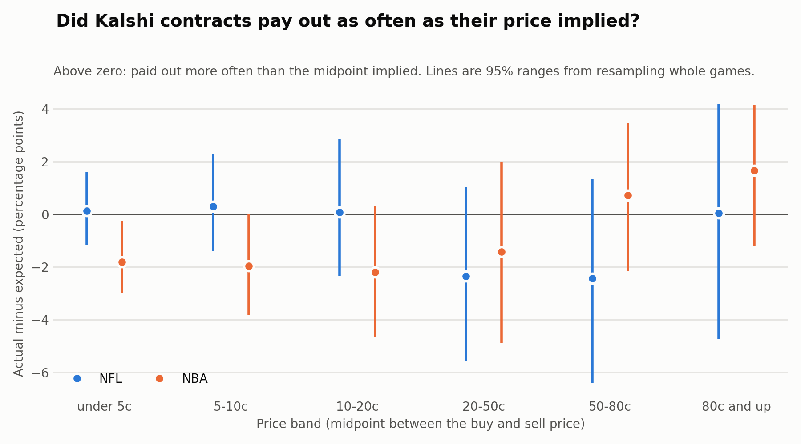
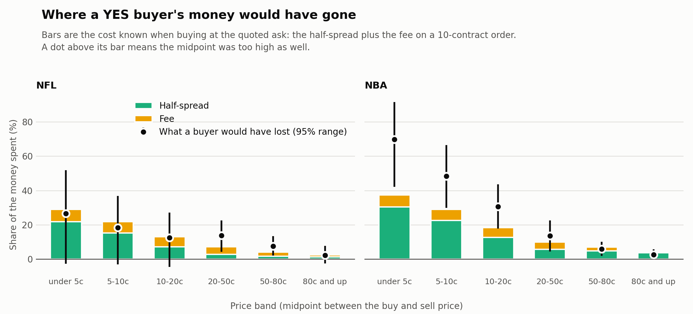
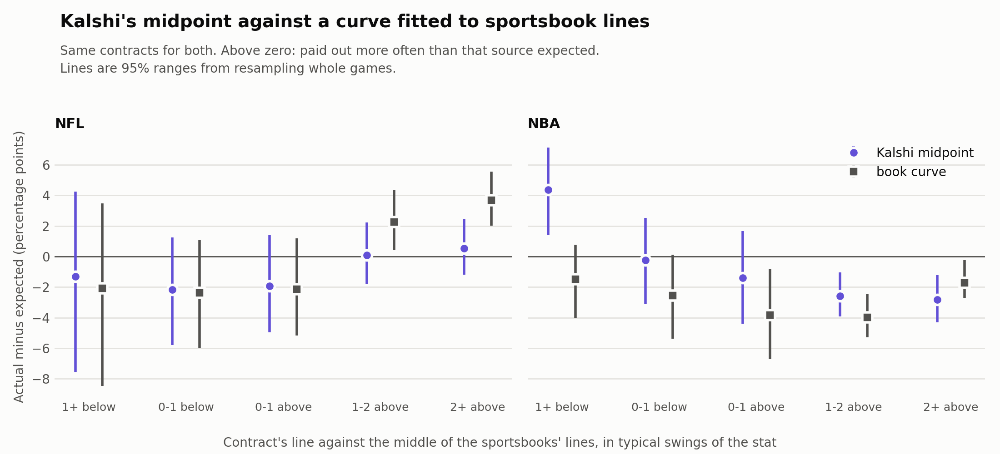

# Do Kalshi prices match what happened?

**An actual-versus-expected study of prediction-market prices.** Harrison Hong, November 2026.

A one-page version is in [one_page_summary.pdf](one_page_summary.pdf).

## Summary

A Kalshi contract priced at 10 cents implies about a 10% chance. This study checks that against
17,653 settled NFL and NBA player-prop contracts from 88 games, 5 October to 9 November 2026.

1. **No measurable gap between prices and outcomes.** Measured at the midpoint between the buy
   and sell price, contracts in every price band paid out within -2.0 to +0.9 percentage points of
   what the price implied, and no band's 95% range excludes zero. That is not proof the prices
   were right: the data cannot rule out a gap of up to 4.5 points in a band.
2. **What a buyer would have lost was mostly the cost of trading.** Buying YES on every contract
   at the quoted ask and holding it to settlement would have returned -9.9% (95% range -14.2% to
   -5.9%). The half-spread and the fee, both known before buying, were 75% of that loss. Dropping
   any one game leaves the return in the range -11.0% to -9.2%. This is a hypothetical return at
   quoted prices, not a trading record.
3. **Kalshi was as accurate as a curve fitted to sportsbook lines,** except on rare outcomes,
   where the curve was wrong in opposite directions in the two leagues.

The sample is small. Only the price bands from 50 cents up reach full credibility, so every
result below comes with a range, and several things that look like findings are not established.

This is a study of prices. It contains no picks and is not betting advice.

## The question

Insurers compare what they priced for with what happened, and call it an actual-versus-expected
study. A prediction market sets a price on an event, so the same test applies: of the contracts
priced near 10 cents, did about 10% pay out? If not, is the price wrong, or is the buyer just
paying to trade?

## Data

- **Source.** My own app logged the price to buy YES and the price to buy NO for each contract
  before the game, from Kalshi's public API. Results are Kalshi's own settlements.
- **Contracts.** Each one asks whether a player will go over a line: passing, rushing and
  receiving yards, receptions and passing touchdowns in the NFL; points, rebounds, assists and
  three-pointers in the NBA. A player has a ladder of lines in each game.
- **Size.** 17,990 rows were read. 105 were settled part-way (for example, the player left the
  game) and are left out. Of the rest, 17,653 have both a buy and a sell price, so they have a
  midpoint. They cover 88 games (49 NFL, 39 NBA) and 1,119 player-games. The data checks table
  below has the full count.
- **Collection.** Each scan of a game saves one row per contract with the time of the scan. At
  least three hours after the start, the app fills in Kalshi's settlement for the same contract
  ticker. No ticker appears twice.
- **Timing.** Prices were logged a median of 1.5 hours before the start for NFL games and 3.2
  hours for NBA games. 78% of contracts were logged within 6 hours of the start, and the longest
  gap was 117 hours. The data records when the app read each price, not when the quote was last
  updated, so the age of the quotes is unknown.
- **Which games.** The games are the ones my app scanned, some automatically shortly before the
  start and some by hand, and only while the app was running. They are not every game played in
  the period and not a random sample.
- **Not in this repository.** The raw price data and the app that collected it are not
  included. The tables in [output/](output/) are archived results: they cannot be regenerated
  from this repository alone. [sample_data/](sample_data/) has made-up data in the same layout,
  so the code can be run and checked, but not the historical numbers.

The script counts what it read and what it left out, and only uses prices logged before the
game started. `output/data_quality.csv` also holds a SHA-256 fingerprint of each input file,
which identifies the exact data behind these results.

| Check | NFL | NBA |
|---|---|---|
| Rows read | 11,547 | 6,443 |
| Logged after the game started (left out) | 0 | 0 |
| Settled part-way (left out) | 49 | 56 |
| Not settled yet (left out) | 0 | 0 |
| Settled yes or no | 11,498 | 6,387 |
| No price to sell YES, so no midpoint | 95 | 137 |
| In the analysis | 11,403 | 6,250 |
| Duplicate tickers | 0 | 0 |
| Games | 49 | 39 |
| Player-games | 671 | 448 |
| First game | 2026-10-05 | 2026-10-20 |
| Last game | 2026-11-09 | 2026-11-07 |

## Method

- **Expected.** The midpoint between the price to buy YES and the price to sell it. The price to
  sell YES is 1 minus the price to buy NO.
- **Actual.** The share of contracts that paid out.
- **What the results describe.** The contracts Kalshi listed for these games, each counted
  once. A player with a longer ladder of lines counts for more, so this is not the same as a
  typical player or a typical game. The robustness section gives each player-game, and each
  game, equal weight instead.
- **Price bands.** Under 5c, 5-10c, 10-20c, 20-50c, 50-80c, and 80c and up, by midpoint.
- **Ranges.** A player's contracts in one game win or lose together, so the contracts are not
  independent. Every 95% range comes from resampling whole games 2,000 times and keeping each
  game's contracts together. That made the ranges 1.1 to 2.0 times wider than treating contracts
  as independent would.
- **Credibility.** The classical standard of 1,082 expected events for full credibility, applied
  to a yes-or-no outcome, then reduced for the clustering by game.
- **Fixed in advance.** The bands, the return formula and the 6-hour cutoff for a "fresh" scan are
  constants at the top of the script. They were set at the start and not tuned to the results.
- **Return.** A hypothetical: buy one order of every contract at the quoted ask, pay the fee, and
  hold to settlement. It is not a record of trades, and the data does not say how many contracts
  were on offer at the ask.
- **Fee.** Kalshi charges 0.07 x price x (1 - price) per contract, rounded up to the next cent on
  the whole order. Fees differ by market, so I checked: on 10 November 2026 Kalshi's API listed
  all ten contract series in this data with its standard fee formula and a multiplier of 1. The
  study uses a 10-contract order, chosen after seeing how much the rounding matters on a single
  contract. The robustness section shows other order sizes.

## Findings

### 1. No measurable gap between prices and outcomes

| Price band | Contracts | Paid out | Expected | Gap in points (95% range) | Credibility if independent | Credibility by game |
|---|---|---|---|---|---|---|
| under 5c | 1,514 | 3.2% | 3.6% | -0.4 (-1.5 to +0.7) | 0.23 | 0.18 |
| 5-10c | 2,621 | 6.8% | 7.1% | -0.3 (-1.7 to +1.3) | 0.43 | 0.29 |
| 10-20c | 3,034 | 13.7% | 14.5% | -0.7 (-2.6 to +1.3) | 0.69 | 0.43 |
| 20-50c | 4,991 | 31.7% | 33.7% | -2.0 (-4.5 to +0.3) | 1.00 | 0.83 |
| 50-80c | 4,021 | 63.3% | 64.5% | -1.1 (-3.9 to +1.4) | 1.00 | 1.00 |
| 80c and up | 1,472 | 86.5% | 85.6% | +0.9 (-2.0 to +3.3) | 1.00 | 1.00 |

- **Both leagues together:** no band's range excludes zero.
- **What that does and doesn't show.** A range that includes zero means the data found no gap,
  not that there is none. The ranges allow a gap of up to 4.5 points in a band. Contracts under
  5c were priced at 3.6% on average, and their true payout rate could be anywhere from 2.1% to 4.3%.
- **Credibility is low for longshots.** The under-5c band has 0.23 of full credibility if
  contracts were independent and 0.18 by game. The 5-10c band has 0.43 and 0.29.

The two leagues differ:

| Price band | NFL gap in points (95% range) | NBA gap in points (95% range) |
|---|---|---|
| under 5c | +0.1 (-1.2 to +1.6) | -1.8 (-3.0 to -0.3) |
| 5-10c | +0.3 (-1.4 to +2.3) | -2.0 (-3.8 to -0.0) |
| 10-20c | +0.1 (-2.3 to +2.8) | -2.2 (-4.6 to +0.3) |
| 20-50c | -2.3 (-5.5 to +1.0) | -1.4 (-4.9 to +2.0) |
| 50-80c | -2.4 (-6.4 to +1.3) | +0.7 (-2.2 to +3.5) |
| 80c and up | 0.0 (-4.7 to +4.2) | +1.7 (-1.2 to +4.2) |

- **NFL:** the three bands under 20c are within 0.3 points of the midpoint.
- **NBA:** contracts under 5c paid out 1.7% of the time against 3.5% expected (range -3.0 to -0.3
  points). That is 7 payouts, and one of 12 league-band comparisons, so chance could produce it.

### 2. What a buyer would have lost was mostly the cost of trading

A buyer pays the ask plus the fee and gets $1 if the contract pays out. The loss per contract
splits exactly into three parts:

    (ask + fee) - payout  =  (ask - midpoint)  +  fee  +  (midpoint - payout)
                              the half-spread              the midpoint being wrong

The half-spread is half the gap between the buy and sell price: what a buyer pays above the
midpoint. It and the fee are known when you buy. Each part below is a share of the money spent
on YES.

| Price band | Average ask | Half-spread | Fee | Midpoint error (95% range) | Return (95% range) |
|---|---|---|---|---|---|
| under 5c | 4.8c | 24.4% | 7.1% | +7.7% (-13.4% to +28.6%) | -39.2% (-60.4% to -17.9%) |
| 5-10c | 8.7c | 17.3% | 6.5% | +3.0% (-13.7% to +17.9%) | -26.7% (-41.2% to -10.5%) |
| 10-20c | 16.0c | 9.2% | 5.7% | +4.2% (-7.8% to +15.2%) | -19.1% (-29.8% to -7.3%) |
| 20-50c | 35.1c | 3.8% | 4.3% | +5.5% (-0.8% to +12.2%) | -13.7% (-20.1% to -7.5%) |
| 50-80c | 66.5c | 3.0% | 2.3% | +1.7% (-2.0% to +5.7%) | -6.9% (-10.8% to -3.3%) |
| 80c and up | 87.9c | 2.6% | 0.9% | -1.0% (-3.7% to +2.3%) | -2.5% (-5.7% to +0.2%) |
| all prices | 36.9c | 4.4% | 3.0% | +2.5% (-1.7% to +6.9%) | -9.9% (-14.2% to -5.9%) |

- **Overall:** of each dollar spent, 4.4% went to the half-spread, 3.0% to the fee and 2.5% (range
  -1.7% to +6.9%) to the midpoint being too high. The midpoint part cannot be told apart from zero.
- **Longshots cost the most because of the half-spread.** A half-spread of about a cent is 24.4%
  of the money spent on a contract under 5c, where the return was -39.2%. At 80c and up it was -2.5%.

Longshots by league:

| League | Price band | Half-spread | Fee | Midpoint error (95% range) | Return (95% range) |
|---|---|---|---|---|---|
| NFL | under 5c | 21.9% | 7.2% | -2.5% (-31.4% to +23.0%) | -26.5% (-51.8% to +2.7%) |
| NFL | 5-10c | 15.3% | 6.5% | -3.3% (-25.4% to +15.5%) | -18.4% (-36.8% to +3.1%) |
| NBA | under 5c | 30.4% | 6.9% | +32.4% (+4.4% to +53.9%) | -69.7% (-91.5% to -42.1%) |
| NBA | 5-10c | 22.6% | 6.4% | +19.4% (+0.1% to +38.4%) | -48.4% (-66.4% to -29.8%) |

- **NFL:** the half-spread and fee explain the whole longshot loss. The midpoint part is -2.5% under 5c.
- **NBA:** under 5c, the midpoint error (32.4%) is as large as the half-spread (30.4%). This is
  the NBA result from finding 1, in dollars.
- **NBA half-spreads are wider:** 2.6 cents on average against 1.1 cents in the NFL.

### 3. Kalshi against a curve fitted to sportsbook lines

The second opinion is a curve my app fits to sportsbook lines. For each player and stat it takes
the middle of the sportsbooks' lines and draws a curve around it (a bell curve for yards and
points, a count curve for receptions, touchdowns, rebounds, assists and threes). That gives a
chance of going over any line, including lines the sportsbooks don't quote. It is my
extrapolation from sportsbook lines, not a sportsbook's own price.

The curve's widths were set from earlier seasons: the NFL ones before the first NFL game here and
the NBA ones two weeks before the first NBA game. They were not changed during the sample, so
every game here is one the curve had not seen.

**Overall accuracy is a tie.** The Brier score is the average squared miss between the chance
given and what happened, so lower is better.

| Sample | Scans | Contracts | Games | Kalshi midpoint | Book curve | Same chance for all | Kalshi minus book (95% range) |
|---|---|---|---|---|---|---|---|
| NFL + NBA | all | 17,653 | 88 | 0.1527 | 0.1527 | 0.2251 | 0.0000 (-0.0006 to +0.0007) |
| NFL | all | 11,403 | 49 | 0.1530 | 0.1535 | 0.2148 | -0.0005 (-0.0011 to +0.0001) |
| NBA | all | 6,250 | 39 | 0.1521 | 0.1511 | 0.2393 | +0.0010 (-0.0004 to +0.0026) |
| NFL + NBA | within 6 hours of the start | 13,821 | 62 | 0.1516 | 0.1517 | 0.2257 | -0.0002 (-0.0008 to +0.0005) |
| NFL | within 6 hours of the start | 8,375 | 31 | 0.1530 | 0.1535 | 0.2149 | -0.0005 (-0.0012 to +0.0002) |
| NBA | within 6 hours of the start | 5,446 | 31 | 0.1493 | 0.1490 | 0.2384 | +0.0003 (-0.0008 to +0.0015) |
| NFL + NBA | more than 6 hours before | 3,832 | 26 | 0.1566 | 0.1560 | 0.2230 | +0.0006 (-0.0012 to +0.0032) |
| NFL | more than 6 hours before | 3,028 | 18 | 0.1529 | 0.1536 | 0.2144 | -0.0007 (-0.0017 to +0.0006) |
| NBA | more than 6 hours before | 804 | 8 | 0.1706 | 0.1653 | 0.2446 | +0.0053 (-0.0022 to +0.0151) |

- **Both leagues, all scans:** 0.1527 for each, against 0.2251 for giving every contract the same
  chance. The range on the difference is -0.0006 to +0.0007.
- **Timing:** the tie holds for scans within 6 hours of the start and for earlier ones. NBA
  scores look worse on early scans, but that is 8 games and there is no range on that comparison.

**Rare outcomes are where the two differ.** These are the contracts each source gave under a 5% chance.

| League | Source | Contracts | Payouts | Paid out | Expected | Gap in points (95% range) |
|---|---|---|---|---|---|---|
| NFL | Kalshi midpoint | 1,098 | 41 | 3.7% | 3.6% | +0.1 (-1.2 to +1.6) |
| NFL | book curve | 2,280 | 126 | 5.5% | 2.3% | +3.2 (+1.7 to +4.8) |
| NBA | Kalshi midpoint | 416 | 7 | 1.7% | 3.5% | -1.8 (-3.0 to -0.3) |
| NBA | book curve | 362 | 3 | 0.8% | 3.3% | -2.5 (-3.4 to -1.1) |

- **NFL:** events the curve called rare happened 5.5% of the time against 2.3% expected. Kalshi's
  own rare contracts paid out 3.7% against 3.6%.
- **NBA:** the curve erred the other way, 0.8% against 3.3%, on 3 payouts.

The same contracts, grouped by how far the line is from the middle of the sportsbooks' lines
(in typical game-to-game swings of the stat), show where each source drifts:

| League | Line against the books' middle | Contracts | Paid out | Kalshi midpoint said | Book curve said | Kalshi gap in points (95% range) | Book curve gap in points (95% range) |
|---|---|---|---|---|---|---|---|
| NFL | 1+ below | 314 | 86.3% | 87.6% | 88.4% | -1.3 (-7.6 to +4.3) | -2.1 (-8.5 to +3.5) |
| NFL | 0-1 below | 2,919 | 63.5% | 65.7% | 65.9% | -2.2 (-5.8 to +1.2) | -2.4 (-6.0 to +1.1) |
| NFL | 0-1 above | 3,576 | 28.9% | 30.9% | 31.1% | -1.9 (-5.0 to +1.4) | -2.1 (-5.2 to +1.2) |
| NFL | 1-2 above | 3,177 | 10.3% | 10.2% | 8.1% | +0.1 (-1.8 to +2.2) | +2.3 (+0.4 to +4.4) |
| NFL | 2+ above | 1,417 | 5.2% | 4.6% | 1.5% | +0.5 (-1.2 to +2.5) | +3.7 (+2.0 to +5.6) |
| NBA | 1+ below | 685 | 89.2% | 84.8% | 90.7% | +4.4 (+1.4 to +7.1) | -1.5 (-4.0 to +0.8) |
| NBA | 0-1 below | 1,981 | 63.6% | 63.8% | 66.1% | -0.2 (-3.1 to +2.5) | -2.5 (-5.4 to +0.1) |
| NBA | 0-1 above | 2,080 | 25.7% | 27.1% | 29.6% | -1.4 (-4.4 to +1.7) | -3.8 (-6.7 to -0.8) |
| NBA | 1-2 above | 1,294 | 5.6% | 8.2% | 9.6% | -2.6 (-3.9 to -1.0) | -4.0 (-5.3 to -2.5) |
| NBA | 2+ above | 210 | 1.0% | 3.8% | 2.7% | -2.8 (-4.3 to -1.2) | -1.7 (-2.7 to -0.2) |

- **NFL, 2+ swings above the middle:** 5.2% paid out. Kalshi said 4.6% and the curve said 1.5%.
  The curve's tails are too thin; Kalshi's are not.
- **NBA, above the middle:** both sources rated these too high.
- **NBA, 1+ swings below the middle:** Kalshi's midpoint was too low. Wide NBA spreads may pull
  the midpoint down there, but this study does not test that.

## Robustness checks

**Does one game drive a result?** Each headline result was worked out again with every game
dropped in turn. The table shows the lowest and highest value that gives.

| Result | Games | Full sample | Lowest with one game dropped | Highest with one game dropped |
|---|---|---|---|---|
| Return from buying YES, all prices, both leagues | 88 | -9.9% | -11.0% | -9.2% |
| Return from buying YES under 5c, both leagues | 86 | -39.2% | -43.3% | -37.9% |
| Midpoint error as a share of money spent, both leagues | 88 | +2.5% | +1.7% | +3.5% |
| NBA under 5c: actual minus expected (points) | 38 | -1.8 | -2.2 | -1.7 |
| NFL contracts the book curve gave under 5%: actual minus expected (points) | 48 | +3.2 | +2.8 | +3.4 |
| Brier score, Kalshi minus book curve, both leagues (Brier) | 88 | 0.0000 | -0.0002 | +0.0001 |

- **No single game drives any of them.** The overall return stays in the range -11.0% to -9.2%,
  and the return under 5c in -43.3% to -37.9%.
- **The two league results keep their sign.** The NBA under-5c gap stays in -2.2 to -1.7 points
  and the NFL book-curve gap in +2.8 to +3.4 points. This does not make them proven: the 95%
  ranges in the findings above are the measure of that.

**Does it matter that some players have more contracts?** The main results count each contract
once. Here each player-game, then each game, gets equal weight instead.

| Result | Each contract counted once | Each player-game equal | Each game equal |
|---|---|---|---|
| Return from buying YES, all prices | -9.9% | -9.2% | -10.0% |
| Midpoint error as a share of money spent, all prices | +2.5% | +1.2% | +1.3% |
| Actual minus expected, all contracts (points) | -1.0 | -0.5 | -0.5 |
| Actual minus expected, under 5c (points) | -0.4 | -0.6 | -0.5 |

- **The return barely moves:** -9.2% with each player-game equal and -10.0% with each game equal.
- **The midpoint error is about half as large** under either equal weighting, which fits the
  finding that it cannot be told apart from zero.

**Does the order size change the return?** Kalshi rounds the fee up to the next cent on the whole
order, so small orders pay more fee per contract.

| Price band | No fee | 100 contracts | 10 contracts | 1 contract |
|---|---|---|---|---|
| under 5c | -34.5% | -38.7% | -39.2% | -45.7% |
| 5-10c | -21.7% | -26.4% | -26.7% | -29.8% |
| 10-20c | -14.2% | -18.9% | -19.1% | -20.8% |
| 20-50c | -9.8% | -13.6% | -13.7% | -14.7% |
| 50-80c | -4.8% | -6.9% | -6.9% | -7.5% |
| 80c and up | -1.6% | -2.4% | -2.5% | -2.8% |
| all prices | -7.1% | -9.8% | -9.9% | -10.9% |

- **Under 5c:** -34.5% with no fee, -38.7% on a 100-contract order and -45.7% on a single contract.
- **These are prices on screen, not fills.** The data has no order sizes, so the study cannot say
  how many contracts could have been bought at the ask.

## Limits

- **Small sample.** Five weeks of one season and 88 games. Only the bands from 50c up reach full credibility.
- **Chosen games.** The games are the ones I chose to scan, not a random sample.
- **Many comparisons.** With two leagues and several bands, a few ranges will exclude zero by chance.
- **YES side only.** YES means the player goes over the line. A NO buyer pays the same
  half-spread in cents, with the midpoint part reversed.
- **Hypothetical returns.** Returns are at quoted asks with an assumed order size. They are not
  trades, and real fills could be worse.
- **Not reproducible from this repository.** The historical numbers depend on raw data and a
  collection app that are not published.
- **The midpoint depends on the quotes.** Where spreads are wide, the midpoint is a rough estimate of the market's view.
- **No order sizes.** The data has prices but not how many contracts were on offer at them.
- **Resampling is by game.** It does not allow for links between games, such as one player
  appearing in several.
- **The book curve is mine.** Its misses on rare outcomes say more about the curve than about sportsbooks.

## Run it

    python3 -m venv .venv
    .venv/bin/pip install -r requirements.txt
    .venv/bin/python -m pytest
    .venv/bin/python study.py PATH/kalshi_record.csv PATH/nba_kalshi_record.csv

To try it without real data, run it on the made-up sample files. The numbers that come out
mean nothing; they only show the script works end to end.

    .venv/bin/python study.py sample_data/nfl_sample.csv sample_data/nba_sample.csv --out demo_output

The tests run on made-up data and need no price data. The study itself needs two CSV files, one
per league, with these columns: `event_id`, `player`, `game_time`, `logged_at`, `yes_ask`,
`no_ask`, `result` (`yes`, `no` or `scalar`), `books_over`, `line`, `middle` and `distance`.
A `ticker` column is optional and is used to check for duplicates.

## What's here

- `study.py`: the whole analysis. It prints every table and writes the files below.
- `tests/`: tests for each calculation, and a test that every headline number and table row in
  this README matches the script's output.
- `output/`: the tables of results as CSV, plus `key_numbers.json` and `tables.md`, which this
  README and the PDF are filled from, and `data_quality.csv`, the record of what was read.
- `charts/`: the three charts.
- `sample_data/`: made-up data in the same layout as the real data, and the script that makes it.
- `one_page_summary.pdf`: the one-page version, written by the script.
