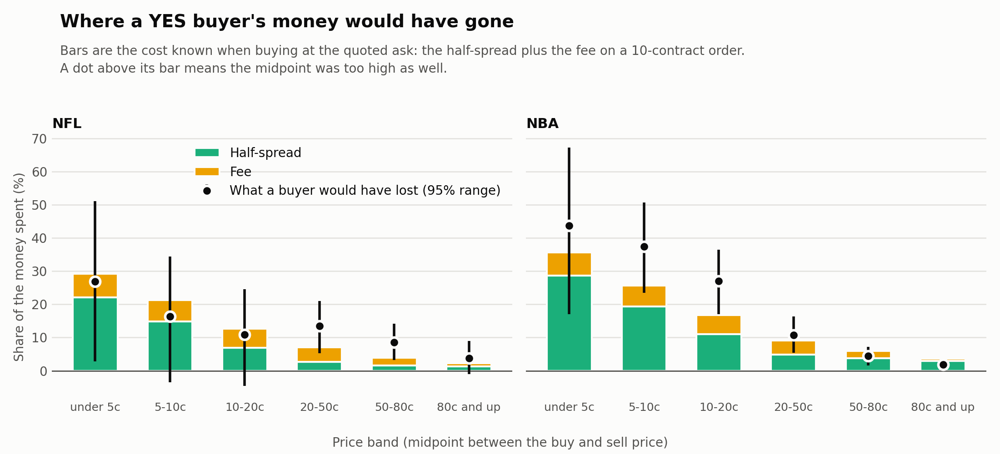

# Do Kalshi prices match what happened?

**An actual-versus-expected study of prediction-market prices.** Harrison Hong, November 2026.

**Interactive results page:** https://harrisonhong21.github.io/kalshi-actual-vs-expected/
(switch between leagues and see every price band with its range).
A one-page version is in [one_page_summary.pdf](one_page_summary.pdf).

## Summary

A Kalshi contract priced at 10 cents implies about a 10% chance. This study checks that against
21,118 settled NFL and NBA player-prop contracts from 107 games, 5 October to 12 November 2026.

1. **No measurable gap between prices and outcomes.** Measured at the midpoint between the buy
   and sell price, contracts in every price band paid out within -1.9 to +1.2 percentage points of
   what the price implied, and no band's 95% range excludes zero. That is not proof the prices
   were right: the data cannot rule out a gap of up to 4.1 points in a band.
2. **What a buyer would have lost was mostly the cost of trading.** Buying YES on every contract
   at the quoted ask and holding it to settlement would have returned -9.3% (95% range -12.8% to
   -5.8%). The half-spread and the fee, both known before buying, were 79% of that loss. Dropping
   any one game leaves the return in the range -10.2% to -8.7%. This is a hypothetical return at
   quoted prices, not a trading record.
3. **Kalshi and a curve fitted to sportsbook lines scored almost the same overall.** They
   differed on rare outcomes in the NFL, where the curve gave them too low a chance and Kalshi's
   midpoint was close to what happened.

**Version 1.1** adds 19 NBA games (10 to 12 November) to version 1.0, with the method unchanged.
The headline results held. One league result from version 1.0 did not: see
[Version history](#version-history).

The sample is small. Only the price bands from 50 cents up reach full credibility, so every
result below comes with a range, and several things that look like findings are not established.
Results for a single league are exploratory: with two leagues and several bands, some ranges
will exclude zero by chance.

This is a study of prices. It contains no picks and is not betting advice.

## What this project demonstrates

- **Framing a question so data can answer it.** An insurer's actual-versus-expected test, applied
  to a market price: did contracts priced near 10 cents pay out about 10% of the time?
- **Honest uncertainty.** Every result has a 95% range from resampling whole games, because a
  player's contracts in one game win or lose together. A credibility standard says which bands
  have enough data to lean on.
- **Separating causes.** The loss a buyer would have taken is split exactly into the half-spread,
  the fee and the midpoint being wrong, so a cost known in advance is not mistaken for a pricing error.
- **Checking my own result.** Leave-one-game-out, two other weightings, three order sizes, and a
  written list of which choices were made after seeing results.
- **Work someone else can check.** One Python script, tests for each calculation that run on
  GitHub on every push, a test that this README quotes the script's output exactly, sample data
  to run it on, and a results page built from the same tables.

## The question

Insurers compare what they priced for with what happened, and call it an actual-versus-expected
study. A prediction market sets a price on an event, so the same test applies: of the contracts
priced near 10 cents, did about 10% pay out? If not, is the price wrong, or is the buyer just
paying to trade?

## Data

- **Source.** My own app logged the price to buy YES and the price to buy NO for each contract
  before the game, from Kalshi's public API. Results are Kalshi's own settlements.
- **Contracts.** Each one asks whether a player will go over a line: passing, rushing and
  receiving yards, receptions and passing touchdowns in the NFL; points, rebounds, assists and
  three-pointers in the NBA. A player has a ladder of lines in each game.
- **Size.** 21,529 rows were read. 155 were settled part-way (for example, the player left the
  game) and are left out. Of the rest, 21,118 have both a buy and a sell price, so they have a
  midpoint. They cover 107 games (49 NFL, 58 NBA) and 1,373 player-games. The data checks table
  below has the full count.
- **Collection.** Each scan of a game saves one row per contract with the time of the scan. If a
  game was scanned more than once before it started, the latest scan replaces the earlier one,
  and the app does not save prices for a game that has started. At least three hours after the
  start, it fills in Kalshi's settlement for the same contract ticker. No ticker appears twice.
- **Timing.** Prices were logged a median of 1.5 hours before the start for NFL games and 2.7
  hours for NBA games. 80% of contracts were logged within 6 hours of the start, and the longest
  gap was 117 hours. The data records when the app read each price, not when the quote was last
  updated, so the age of the quotes is unknown.
- **Which games.** The games are the ones my app scanned, some automatically shortly before the
  start and some by hand, and only while the app was running. They are not every game played in
  the period and not a random sample.
- **Cutoff.** Version 1.1 uses every game the app had recorded with a start on or before 13
  November 2026 (Eastern time). The last recorded game was on 12 November. The app recorded no
  NFL games after 9 November in that window, so the NFL data is the same as in version 1.0.
- **Not in this repository.** The raw price data and the app that collected it are not
  included. The tables in [output/](output/) are archived results: they cannot be regenerated
  from this repository alone. [sample_data/](sample_data/) has made-up data in the same layout,
  so the code can be run and checked, but not the historical numbers.

The script counts what it read and what it left out, and only uses prices logged before the
game started. `output/data_quality.csv` also holds a SHA-256 fingerprint of each input file,
which identifies the exact data behind these results.

| Check | NFL | NBA |
|---|---|---|
| Rows read | 11,547 | 9,982 |
| Logged after the game started (left out) | 0 | 0 |
| Settled part-way (left out) | 49 | 106 |
| Not settled yet (left out) | 0 | 0 |
| Settled yes or no | 11,498 | 9,876 |
| No price to sell YES, so no midpoint | 95 | 161 |
| In the analysis | 11,403 | 9,715 |
| Duplicate tickers | 0 | 0 |
| Book-curve version stamped on the rows | 2026-10-05.1 | 2026-10-05.1 |
| Games | 49 | 58 |
| Player-games | 671 | 702 |
| First game | 2026-10-05 | 2026-10-20 |
| Last game | 2026-11-09 | 2026-11-12 |

The script also stops with an error if a price is blank or outside 0 to 1, if a price to buy
YES is below the price to sell it, or if a result is not yes, no or scalar.

**Who was left out for having no midpoint.** 256 settled contracts had a price to buy YES but
nobody offering to buy it from you, so there is no price to sell and no midpoint.

| League | Group | Contracts | Average ask | Asking under 10c | Paid out | Book curve said |
|---|---|---|---|---|---|---|
| NFL | In the analysis | 11,403 | 33.5c | 22.1% | 31.2% | 31.5% |
| NFL | Left out: no price to sell YES | 95 | 5.6c | 95.8% | 2.1% | 2.8% |
| NBA | In the analysis | 9,715 | 42.6c | 13.1% | 39.9% | 42.3% |
| NBA | Left out: no price to sell YES | 161 | 7.8c | 77.0% | 6.8% | 5.5% |

- **They are mostly longshots.** 95.8% of the NFL ones and 77.0% of the NBA ones were asking
  under 10c, and they rarely paid out.
- **What that means for the results.** The study describes contracts with a quote on both
  sides. The thinnest longshots, where a buyer faces the worst terms, are under-represented.

## Method

- **Expected.** The midpoint between the price to buy YES and the price to sell it. The price to
  sell YES is 1 minus the price to buy NO.
- **Actual.** The share of contracts that paid out.
- **What the results describe.** The contracts Kalshi listed for these games, each counted
  once. A player with a longer ladder of lines counts for more, so this is not the same as a
  typical player or a typical game. The robustness section gives each player-game, and each
  game, equal weight instead.
- **Price bands.** Under 5c, 5-10c, 10-20c, 20-50c, 50-80c, and 80c and up, by midpoint.
- **Ranges.** A player's contracts in one game win or lose together, so the contracts are not
  independent. Every 95% range comes from resampling whole games 2,000 times and keeping each
  game's contracts together. The standard error of each band's gap from that resampling was 1.1
  to 2.0 times the standard error that independent contracts would give.
- **Credibility.** The classical standard of 1,082 expected events for full credibility, applied
  to a yes-or-no outcome. It means a 90% chance of being within 5% of the true rate, which is a
  different yardstick from the 95% ranges; the two are reported side by side, not combined. The
  "by game" figure is an approximation: it shrinks the number of contracts by the square of the
  standard-error ratio above.
- **Return.** A hypothetical: buy one order of every contract at the quoted ask, pay the fee, and
  hold to settlement. It is not a record of trades, and the data does not say how many contracts
  were on offer at the ask.
- **Fee.** Kalshi charges 0.07 x price x (1 - price) per contract, rounded up to the next cent on
  the whole order. Fees differ by market, so I checked: on 10 November 2026 Kalshi's API listed
  all ten contract series in this data with its standard fee formula and a multiplier of 1. The
  study uses a 10-contract order, chosen after seeing how much the rounding matters on a single
  contract. The robustness section shows other order sizes.

## What was decided when

Nothing in this study was registered in advance. The project was first published in a single
commit, so there is no dated record of the order of decisions. This is my own account of it.

Chosen at the first look at the data and not changed since:

- the six price bands;
- the midpoint as the expected chance;
- the return formula: buy at the ask, pay the fee, hold to settlement;
- resampling whole games for every range;
- the 6-hour cutoff for a "fresh" scan.

Chosen later, after seeing results:

- the 10-contract order size for the fee;
- the 5% line for a rare outcome and the distance bands in finding 3;
- the cost-of-trading yardstick in finding 1;
- every check in the robustness section.

Version 1.1 added the games recorded after version 1.0 and changed nothing else. The decision
to add them was made after seeing the version 1.0 results, and the cutoff was set to every
recorded game up to the day the data was copied, not chosen to suit the results.

## Findings

### 1. No measurable gap between prices and outcomes

| Price band | Contracts | Paid out | Expected | Gap in points (95% range) | Credibility if independent | Credibility by game |
|---|---|---|---|---|---|---|
| under 5c | 1,753 | 3.4% | 3.6% | -0.1 (-1.1 to +0.9) | 0.24 | 0.20 |
| 5-10c | 3,021 | 6.9% | 7.1% | -0.2 (-1.4 to +1.1) | 0.46 | 0.33 |
| 10-20c | 3,615 | 13.6% | 14.5% | -0.9 (-2.6 to +0.9) | 0.75 | 0.49 |
| 20-50c | 5,932 | 31.8% | 33.7% | -1.9 (-4.1 to +0.2) | 1.00 | 0.95 |
| 50-80c | 4,860 | 63.9% | 64.5% | -0.6 (-2.9 to +1.7) | 1.00 | 1.00 |
| 80c and up | 1,937 | 87.1% | 85.9% | +1.2 (-1.1 to +3.2) | 1.00 | 1.00 |

- **Both leagues together:** no band's range excludes zero.
- **What that does and doesn't show.** A range that includes zero means the data found no gap,
  not that there is none. The ranges allow a gap of up to 4.1 points in a band. Contracts under
  5c were priced at 3.6% on average. For the games sampled here, the 95% range puts their payout
  rate anywhere from 2.4% to 4.5%. The games were not chosen at random, so that range does not
  carry over to Kalshi as a whole.
- **Is any gap big enough to matter?** One rough yardstick is the average cost of trading in
  each band: the half-spread plus the fee per contract on a 10-contract order. In 4 of 6 bands
  the whole range sits inside that cost. In the other two the range is too wide to rule out a
  gap larger than it. This compares averages across a band. It says nothing about whether any
  single contract could be traded at a profit.

| Price band | Gap in points (95% range) | Trading cost per contract on a 10-contract order, points | Range inside the cost? |
|---|---|---|---|
| under 5c | -0.1 (-1.1 to +0.9) | 1.7 | yes |
| 5-10c | -0.2 (-1.4 to +1.1) | 2.2 | yes |
| 10-20c | -0.9 (-2.6 to +0.9) | 2.6 | yes |
| 20-50c | -1.9 (-4.1 to +0.2) | 3.0 | no |
| 50-80c | -0.6 (-2.9 to +1.7) | 3.6 | yes |
| 80c and up | +1.2 (-1.1 to +3.2) | 3.1 | no |

- **Credibility is low for longshots.** The under-5c band has 0.24 of full credibility if
  contracts were independent and 0.20 by game. The 5-10c band has 0.46 and 0.33.

The two leagues differ. These league results are exploratory:

| Price band | NFL gap in points (95% range) | NBA gap in points (95% range) |
|---|---|---|
| under 5c | +0.1 (-1.2 to +1.6) | -0.6 (-2.0 to +1.1) |
| 5-10c | +0.3 (-1.4 to +2.3) | -1.1 (-2.6 to +0.4) |
| 10-20c | +0.1 (-2.3 to +2.8) | -2.1 (-4.1 to -0.0) |
| 20-50c | -2.3 (-5.5 to +1.0) | -1.4 (-3.8 to +1.1) |
| 50-80c | -2.4 (-6.4 to +1.3) | +1.1 (-1.3 to +3.4) |
| 80c and up | 0.0 (-4.7 to +4.2) | +1.8 (-0.4 to +3.7) |

- **NFL:** the three bands under 20c are within 0.3 points of the midpoint.
- **NBA:** contracts under 5c paid out 2.9% of the time against 3.5% expected (range -2.0 to +1.1
  points), on 19 payouts. In version 1.0 this gap excluded zero; with 19 more games it no longer
  does. The 10-20c band's range now reaches just to zero, one of 12 league-band comparisons, so
  chance could produce it.

### 2. What a buyer would have lost was mostly the cost of trading

A buyer pays the ask plus the fee and gets $1 if the contract pays out. The loss per contract
splits exactly into three parts:

    (ask + fee) - payout  =  (ask - midpoint)  +  fee  +  (midpoint - payout)
                              the half-spread              the midpoint being wrong

The half-spread is half the gap between the buy and sell price: what a buyer pays above the
midpoint. It and the fee are known when you buy. Each part below is a share of the money spent
on YES.

| Price band | Average ask | Half-spread | Fee | Midpoint error (95% range) | Return (95% range) |
|---|---|---|---|---|---|
| under 5c | 4.8c | 24.7% | 7.1% | +2.6% (-18.2% to +21.4%) | -34.4% (-53.3% to -13.7%) |
| 5-10c | 8.7c | 17.3% | 6.5% | +2.2% (-12.0% to +15.0%) | -25.9% (-38.5% to -11.8%) |
| 10-20c | 16.1c | 9.3% | 5.7% | +5.3% (-5.2% to +15.1%) | -20.3% (-30.0% to -10.0%) |
| 20-50c | 35.1c | 3.9% | 4.3% | +5.2% (-0.6% to +11.1%) | -13.5% (-19.2% to -7.7%) |
| 50-80c | 66.6c | 3.0% | 2.3% | +0.9% (-2.5% to +4.3%) | -6.2% (-9.6% to -3.0%) |
| 80c and up | 88.3c | 2.7% | 0.8% | -1.3% (-3.6% to +1.2%) | -2.2% (-4.7% to +0.1%) |
| all prices | 37.7c | 4.4% | 3.0% | +2.0% (-1.7% to +5.4%) | -9.3% (-12.8% to -5.8%) |

- **Overall:** of each dollar spent, 4.4% went to the half-spread, 3.0% to the fee and 2.0% (range
  -1.7% to +5.4%) to the midpoint being too high. The midpoint part cannot be told apart from zero.
- **Longshots cost the most because of the half-spread.** A half-spread of about a cent is 24.7%
  of the money spent on a contract under 5c, where the return was -34.4%. At 80c and up it was -2.2%.

Longshots by league:

| League | Price band | Half-spread | Fee | Midpoint error (95% range) | Return (95% range) |
|---|---|---|---|---|---|
| NFL | under 5c | 21.9% | 7.2% | -2.5% (-31.4% to +23.0%) | -26.5% (-51.8% to +2.7%) |
| NFL | 5-10c | 15.3% | 6.5% | -3.3% (-25.4% to +15.5%) | -18.4% (-36.8% to +3.1%) |
| NBA | under 5c | 29.3% | 6.9% | +10.5% (-19.7% to +36.8%) | -46.7% (-73.0% to -16.6%) |
| NBA | 5-10c | 20.6% | 6.4% | +11.3% (-4.2% to +27.2%) | -38.3% (-53.4% to -23.6%) |

- **NFL:** the half-spread and fee explain the whole longshot loss. The midpoint part is -2.5% under 5c.
- **NBA:** under 5c, the midpoint error is 10.5%, against a half-spread of 29.3%, and its range
  includes zero. In version 1.0 it was 32.4%, as large as the half-spread.
- **NBA half-spreads are wider:** 2.4 cents on average against 1.1 cents in the NFL.

**The cost hurdle.** The half-spread and the fee set a hurdle. To expect to break even, a buyer's
own estimate of the chance would have to sit that far above the midpoint. Across all prices the
hurdle is 2.9 cents a contract, but what matters is its size next to the price. It is 47% of
the midpoint under 5c and 4% at 80c and up. A longshot buyer would need to be far more right than
a favourite buyer, before the midpoint error is counted at all.

The last column repeats the hypothetical return as if every contract had been bought at the
midpoint instead of the ask. That removes the half-spread but keeps the fee. Across all prices the
return goes from -9.3% to -5.1% (range -8.7% to -1.3%), 4.2 points better, and the range still
excludes zero. This is a best case. A midpoint price needs a resting order, which may not fill, and
tends to fill when the price is about to move against the buyer.

| Price band | Contracts | Average midpoint, cents | Half-spread, cents | Fee, cents | Cost hurdle, cents | Hurdle as share of the midpoint | Return at the ask | Return at the midpoint (95% range) |
|---|---|---|---|---|---|---|---|---|
| under 5c | 1,753 | 3.6 | 1.3 | 0.4 | 1.7 | 47% | -34.4% | -11.4% (-36.9% to +16.7%) |
| 5-10c | 3,021 | 7.1 | 1.6 | 0.6 | 2.2 | 31% | -25.9% | -9.3% (-25.0% to +8.1%) |
| 10-20c | 3,615 | 14.5 | 1.6 | 1.0 | 2.6 | 18% | -20.3% | -11.8% (-22.5% to -0.1%) |
| 20-50c | 5,932 | 33.7 | 1.4 | 1.6 | 3.0 | 9% | -13.5% | -9.9% (-16.0% to -3.8%) |
| 50-80c | 4,860 | 64.5 | 2.1 | 1.5 | 3.6 | 6% | -6.2% | -3.4% (-6.8% to +0.1%) |
| 80c and up | 1,937 | 85.9 | 2.4 | 0.7 | 3.1 | 4% | -2.2% | +0.3% (-2.3% to +2.7%) |
| all prices | 21,118 | 36.0 | 1.7 | 1.2 | 2.9 | 8% | -9.3% | -5.1% (-8.7% to -1.3%) |

Both leagues, all scans, fee on a 10-contract order. Because the average midpoint and hurdle are
rounded, the share column is worked out before rounding.

### 3. Kalshi against a curve fitted to sportsbook lines

The second opinion is a curve my app fits to sportsbook lines. For each player and stat it takes
the middle of the sportsbooks' lines and draws a curve around it (a bell curve for yards and
points, a count curve for receptions, touchdowns, rebounds, assists and threes). That gives a
chance of going over any line, including lines the sportsbooks don't quote. It is my
extrapolation from sportsbook lines, not a sportsbook's own price.

The curve's widths were set from earlier seasons: the NFL ones before the first NFL game here and
the NBA ones two weeks before the first NBA game. They were not changed during the sample, so
every game here is one the curve had not seen.

The curve, for the record:

- **Yards and points** use a bell curve centred on the middle of the sportsbooks' lines. Its
  width is a base plus a share of that middle: passing yards 50 + 0.10 x the middle, rushing
  yards 12 + 0.33 x, receiving yards 12 + 0.40 x, rushing plus receiving yards 16 + 0.28 x, and
  NBA points 4.0 + 0.18 x.
- **Counts** use a count curve whose variance is a multiple of its average: receptions 1.2,
  rebounds 1.4, assists 1.25, three-pointers 1.2, and passing touchdowns 1.
- **Dates.** The NFL settings date from 5 October 2026 and the NBA settings from 6 October 2026.
  Every row in the data carries the same version stamp, 2026-10-05.1.
- **Timing.** Kalshi's prices were saved within minutes of the sportsbook lines they are compared with.

These settings and dates come from my private app's code and history. They cannot be checked
from this repository.

**Overall, the two scored almost the same.** The Brier score is the average squared miss between
the chance given and what happened, so lower is better. The range on the difference includes
zero, which means the data cannot separate them. It does not show they are equally accurate.

| Sample | Scans | Contracts | Games | Kalshi midpoint | Book curve | Same chance for all | Kalshi minus book (95% range) |
|---|---|---|---|---|---|---|---|
| NFL + NBA | all | 21,118 | 107 | 0.1526 | 0.1526 | 0.2281 | 0.0000 (-0.0005 to +0.0006) |
| NFL | all | 11,403 | 49 | 0.1530 | 0.1535 | 0.2148 | -0.0005 (-0.0011 to +0.0001) |
| NBA | all | 9,715 | 58 | 0.1521 | 0.1515 | 0.2398 | +0.0006 (-0.0004 to +0.0018) |
| NFL + NBA | within 6 hours of the start | 16,914 | 79 | 0.1518 | 0.1519 | 0.2292 | -0.0001 (-0.0007 to +0.0004) |
| NFL | within 6 hours of the start | 8,375 | 31 | 0.1530 | 0.1535 | 0.2149 | -0.0005 (-0.0012 to +0.0002) |
| NBA | within 6 hours of the start | 8,539 | 48 | 0.1506 | 0.1504 | 0.2395 | +0.0002 (-0.0006 to +0.0010) |
| NFL + NBA | more than 6 hours before | 4,204 | 28 | 0.1558 | 0.1553 | 0.2238 | +0.0005 (-0.0013 to +0.0026) |
| NFL | more than 6 hours before | 3,028 | 18 | 0.1529 | 0.1536 | 0.2144 | -0.0007 (-0.0017 to +0.0006) |
| NBA | more than 6 hours before | 1,176 | 10 | 0.1633 | 0.1598 | 0.2413 | +0.0035 (-0.0016 to +0.0112) |

- **Both leagues, all scans:** 0.1526 for each, against 0.2281 for giving every contract the same
  chance. The range on the difference is -0.0005 to +0.0006.
- **Timing:** the same holds for scans within 6 hours of the start and for earlier ones. NBA
  scores look worse on early scans, but that is 10 games and the range on the difference includes zero.

**Rare outcomes are where the two differ in the NFL.** These are the contracts each source
gave under a 5% chance. The 5% line was chosen after seeing results, so treat this as exploratory.

| League | Source | Contracts | Payouts | Paid out | Expected | Gap in points (95% range) |
|---|---|---|---|---|---|---|
| NFL | Kalshi midpoint | 1,098 | 41 | 3.7% | 3.6% | +0.1 (-1.2 to +1.6) |
| NFL | book curve | 2,280 | 126 | 5.5% | 2.3% | +3.2 (+1.7 to +4.8) |
| NBA | Kalshi midpoint | 655 | 19 | 2.9% | 3.5% | -0.6 (-2.0 to +1.1) |
| NBA | book curve | 598 | 15 | 2.5% | 3.3% | -0.8 (-2.2 to +0.9) |

- **NFL:** events the curve called rare happened 5.5% of the time against 2.3% expected. Kalshi's
  own rare contracts paid out 3.7% against 3.6%.
- **NBA:** neither source's gap can be told apart from zero. The curve's rare outcomes paid out
  2.5% against 3.3%. In version 1.0 that was 0.8% on 3 payouts, and its range excluded zero.

Those rows judge each source on its own set of contracts. On the contracts that both sources
gave under 5%, the comparison is like for like:

| League | Contracts | Payouts | Paid out | Kalshi midpoint said | Book curve said | Kalshi gap in points (95% range) | Book curve gap in points (95% range) |
|---|---|---|---|---|---|---|---|
| NFL | 1,052 | 39 | 3.7% | 3.6% | 1.9% | +0.1 (-1.2 to +1.7) | +1.8 (+0.4 to +3.3) |
| NBA | 501 | 11 | 2.2% | 3.3% | 3.2% | -1.1 (-2.4 to +0.5) | -1.0 (-2.3 to +0.6) |

- **NFL:** on the same 1,052 contracts, 3.7% paid out. Kalshi said 3.6% and the curve said 1.9%.
- **NBA:** on 501 contracts both sources said about 3.3% and 2.2% paid out, on 11 payouts. Neither
  gap can be told apart from zero.

The same contracts, grouped by how far the line is from the middle of the sportsbooks' lines
(in typical game-to-game swings of the stat), show where each source drifts:

| League | Line against the books' middle | Contracts | Paid out | Kalshi midpoint said | Book curve said | Kalshi gap in points (95% range) | Book curve gap in points (95% range) |
|---|---|---|---|---|---|---|---|
| NFL | 1+ below | 314 | 86.3% | 87.6% | 88.4% | -1.3 (-7.6 to +4.3) | -2.1 (-8.5 to +3.5) |
| NFL | 0-1 below | 2,919 | 63.5% | 65.7% | 65.9% | -2.2 (-5.8 to +1.2) | -2.4 (-6.0 to +1.1) |
| NFL | 0-1 above | 3,576 | 28.9% | 30.9% | 31.1% | -1.9 (-5.0 to +1.4) | -2.1 (-5.2 to +1.2) |
| NFL | 1-2 above | 3,177 | 10.3% | 10.2% | 8.1% | +0.1 (-1.8 to +2.2) | +2.3 (+0.4 to +4.4) |
| NFL | 2+ above | 1,417 | 5.2% | 4.6% | 1.5% | +0.5 (-1.2 to +2.5) | +3.7 (+2.0 to +5.6) |
| NBA | 1+ below | 1,045 | 90.4% | 85.9% | 90.8% | +4.5 (+2.2 to +6.5) | -0.3 (-2.4 to +1.4) |
| NBA | 0-1 below | 3,046 | 64.1% | 64.0% | 66.0% | 0.0 (-2.2 to +2.2) | -1.9 (-4.1 to +0.2) |
| NBA | 0-1 above | 3,211 | 25.8% | 27.3% | 29.4% | -1.4 (-3.7 to +0.9) | -3.6 (-5.8 to -1.3) |
| NBA | 1-2 above | 2,046 | 6.7% | 8.4% | 9.5% | -1.7 (-3.0 to -0.4) | -2.8 (-4.1 to -1.5) |
| NBA | 2+ above | 367 | 2.5% | 3.6% | 2.7% | -1.1 (-2.7 to +0.6) | -0.2 (-1.7 to +1.4) |

- **NFL, 2+ swings above the middle:** 5.2% paid out. Kalshi said 4.6% and the curve said 1.5%.
  In this sample the curve gave these outcomes too low a chance, and Kalshi's midpoint was
  closer to what happened.
- **NBA, 0-2 swings above the middle:** in this sample both sources gave these too high a chance,
  the curve more so.
- **NBA, 1+ swings below the middle:** Kalshi's midpoint was too low. Wide NBA spreads may pull
  the midpoint down there, but this study does not test that.

## Robustness checks

**Does one game drive a result?** Each headline result was worked out again with every game
dropped in turn. The table shows the lowest and highest value that gives.

| Result | Games | Full sample | Lowest with one game dropped | Highest with one game dropped |
|---|---|---|---|---|
| Return from buying YES, all prices, both leagues | 107 | -9.3% | -10.2% | -8.7% |
| Return from buying YES under 5c, both leagues | 105 | -34.4% | -38.0% | -33.2% |
| Midpoint error as a share of money spent, both leagues | 107 | +2.0% | +1.3% | +2.8% |
| NBA under 5c: actual minus expected (points) | 57 | -0.6 | -1.1 | -0.5 |
| NFL contracts the book curve gave under 5%: actual minus expected (points) | 48 | +3.2 | +2.8 | +3.4 |
| Brier score, Kalshi minus book curve, both leagues (Brier) | 107 | 0.0000 | -0.0002 | +0.0001 |

- **No single game drives any of them.** The overall return stays in the range -10.2% to -8.7%,
  and the return under 5c in -38.0% to -33.2%.
- **The two league results keep their sign.** The NBA under-5c gap stays in -1.1 to -0.5 points
  and the NFL book-curve gap in +2.8 to +3.4 points. This does not make them proven: the 95%
  ranges in the findings above are the measure of that.

**Does it matter that some players have more contracts?** The main results count each contract
once. Here each player-game, then each game, gets equal weight instead.

| Result | Each contract counted once | Each player-game equal | Each game equal |
|---|---|---|---|
| Return from buying YES, all prices | -9.3% | -8.7% | -9.3% |
| Midpoint error as a share of money spent, all prices | +2.0% | +0.8% | +1.0% |
| Actual minus expected, all contracts (points) | -0.8 | -0.3 | -0.4 |
| Actual minus expected, under 5c (points) | -0.1 | -0.4 | -0.3 |

- **The return barely moves:** -8.7% with each player-game equal and -9.3% with each game equal.
- **The midpoint error is about half as large** under either equal weighting, which fits the
  finding that it cannot be told apart from zero.

**Does the order size change the return?** Kalshi rounds the fee up to the next cent on the whole
order, so small orders pay more fee per contract.

| Price band | No fee | 100 contracts | 10 contracts | 1 contract |
|---|---|---|---|---|
| under 5c | -29.4% | -33.9% | -34.4% | -41.5% |
| 5-10c | -20.7% | -25.5% | -25.9% | -28.9% |
| 10-20c | -15.5% | -20.2% | -20.3% | -22.0% |
| 20-50c | -9.6% | -13.4% | -13.5% | -14.4% |
| 50-80c | -4.0% | -6.1% | -6.2% | -6.8% |
| 80c and up | -1.4% | -2.1% | -2.2% | -2.6% |
| all prices | -6.6% | -9.2% | -9.3% | -10.3% |

- **Under 5c:** -29.4% with no fee, -33.9% on a 100-contract order and -41.5% on a single contract.
- **These are prices on screen, not fills.** The data has no order sizes, so the study cannot say
  how many contracts could have been bought at the ask.

## Limits

- **Small sample.** Under six weeks of one season and 107 games, and the NFL part has not grown
  since version 1.0. Only the bands from 50c up reach full credibility.
- **Chosen games.** The games are the ones I chose to scan, not a random sample.
- **Many comparisons.** With two leagues and several bands, a few ranges will exclude zero by
  chance. Treat single-league results as exploratory.
- **Not registered in advance.** Some choices were made after seeing results; the section above lists them.
- **Quotes on both sides only.** 256 contracts with no price to sell YES are left out, and most are longshots.
- **YES side only.** YES means the player goes over the line. A NO buyer pays the same
  half-spread in cents, with the midpoint part reversed.
- **Hypothetical returns.** Returns are at quoted asks with an assumed order size. They are not
  trades, and real fills could be worse.
- **Not reproducible from this repository.** The historical numbers depend on raw data and a
  collection app that are not published.
- **The midpoint depends on the quotes.** Where spreads are wide, the midpoint is a rough estimate of the market's view.
- **No order sizes.** The data has prices but not how many contracts were on offer at them.
- **Resampling is by game.** It does not allow for links between games, such as one player
  appearing in several.
- **The book curve is mine.** Its misses on rare outcomes say more about the curve than about
  sportsbooks, and how it was built cannot be checked from this repository.

## What I learned

- **Counting rows overstates what you know.** Treating 21,118 contracts as independent would have
  made every range too narrow. Resampling by game gave standard errors 1.1 to 2.0 times larger.
- **"No gap found" is not "no gap".** No band's range excludes zero, but the ranges still allow a
  gap of up to 4.1 points. I report the width of the range, not just whether it crosses zero.
- **A result that excludes zero can still be noise.** In version 1.0, NBA longshots looked
  overpriced. Nineteen more games shrank that gap to -0.6 points, and its range now includes zero. Single-league results
  were labelled exploratory for this reason.
- **Look at the known costs before blaming the price.** The half-spread and the fee were 79% of
  the hypothetical loss. The part that depends on the price being wrong cannot be told apart from zero.
- **Small rules move small numbers.** Fee rounding alone moves the under-5c return from -33.9% on a
  100-contract order to -41.5% on a single contract, so the order size had to be stated and tested.
- **Say what was decided after seeing results.** Nothing was registered in advance, so the README
  lists which choices came first and which came later, and treats single-league results as exploratory.
- **Let a test guard the write-up.** A test fails if any headline number or table row in this
  README differs from what the script wrote.

## Run it

    python3 -m venv .venv
    .venv/bin/pip install -r requirements.txt
    .venv/bin/python -m pytest
    .venv/bin/python study.py PATH/kalshi_record.csv PATH/nba_kalshi_record.csv

To try it without real data, run it on the made-up sample files. The numbers that come out
mean nothing; they only show the script works end to end.

    .venv/bin/python study.py sample_data/nfl_sample.csv sample_data/nba_sample.csv --out demo_output

The tests run on made-up data and need no price data. The study itself needs two CSV files, one
per league, with these columns: `event_id`, `player`, `game_time`, `logged_at`, `yes_ask`,
`no_ask`, `result` (`yes`, `no` or `scalar`), `books_over`, `line`, `middle` and `distance`.
A `ticker` column is optional and is used to check for duplicates.

To rebuild the results page from the tables in `output/`:

    .venv/bin/python make_dashboard.py

## What's here

- `study.py`: the whole analysis. It prints every table and writes the files below.
- `tests/`: tests for each calculation on made-up data, a test that runs the whole study on the
  sample data, and a test that the headline numbers and table rows the script writes appear in
  this README. That last test catches a README that has drifted from the output. It does not
  prove the numbers are right: that rests on the calculation tests and on the input checks.
- `.github/workflows/tests.yml`: runs the tests on GitHub on every push.
- `output/`: the tables of results as CSV, plus `key_numbers.json` and `tables.md`, which this
  README and the PDF are filled from, and `data_quality.csv`, the record of what was read.
- `charts/`: the three charts.
- `sample_data/`: made-up data in the same layout as the real data, and the script that makes it.
- `one_page_summary.pdf`: the one-page version, written by the script.
- `make_dashboard.py` and `docs/index.html`: the script that builds the interactive results page
  from the tables in `output/`, and the page itself. The data is built into the page.
- `CITATION.cff` and `LICENSE`: how to cite the study, and the MIT licence for the code.

## Version history

- **1.1.0 (15 November 2026).** Adds the 19 NBA games the app recorded from 10 to 12 November:
  107 games and 21,118 contracts, up from 88 and 17,653. The method, price bands and checks are
  unchanged, and the NFL data is the same. The three headline findings held. Two NBA results from
  1.0.0 no longer stand: the gap for NBA contracts under 5c (-1.8 points, range -3.0 to -0.3) is
  now -0.6 (range -2.0 to +1.1), and the book curve's NBA rare-outcome gap (-2.5, range -3.4 to
  -1.1) is now -0.8 (range -2.2 to +0.9). The version 1.0.0 tables are in the
  [v1.0.0 release](https://github.com/HarrisonHong21/kalshi-actual-vs-expected/releases/tag/v1.0.0).
- **1.0.0 (12 November 2026).** 88 games, 5 October to 9 November 2026.

## How to cite

Hong, Harrison (2026). *Do Kalshi prices match what happened? An actual-versus-expected study of
prediction-market prices* (version 1.1.0). Zenodo. https://doi.org/10.5281/zenodo.24177577

That DOI always points to the latest archived version. The code is at
https://github.com/HarrisonHong21/kalshi-actual-vs-expected.

GitHub's "Cite this repository" button gives the same citation in BibTeX and APA form, from
[CITATION.cff](CITATION.cff).

## Licence

The code is under the [MIT licence](LICENSE). The raw price data is not included or licensed here.
