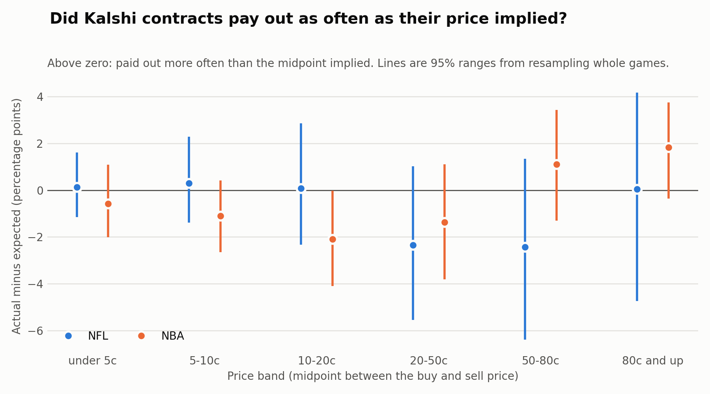
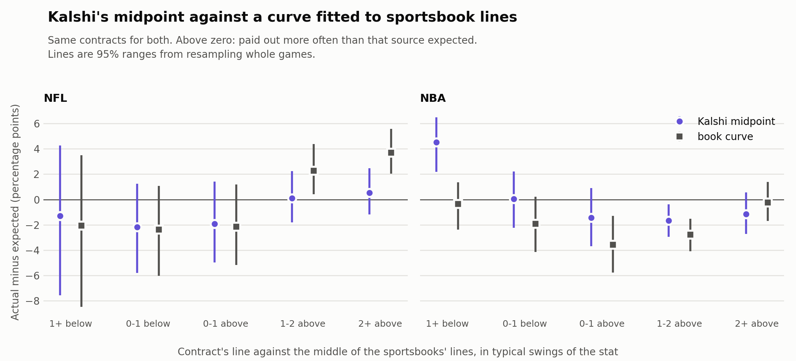

# Do Kalshi prices match what happened?

**An actual-versus-expected study of prediction-market and sportsbook prices, and what my app's
pre-game record ruled in and out.** Harrison Hong, November 2026.

**Interactive results page:** https://harrisonhong21.github.io/kalshi-actual-vs-expected/
(switch between leagues and see every price band with its range).
A one-page version is in [one_page_summary.pdf](one_page_summary.pdf).

## Summary

A Kalshi contract priced at 10 cents implies about a 10% chance. A sportsbook's de-vigged price
on an over implies a chance too. This study checks both against what happened, using the record
my app saved before each game: 24,903 settled Kalshi player-prop contracts from 125 NFL and NBA
games (5 October to 19 November 2026), and 6,113 graded sportsbook props (2,375 NFL from 70
games, 3,738 NBA from 81 games). It then tries the rules for buying Kalshi contracts that the
app was built to test, on the same record.

1. **No measurable gap between Kalshi prices and outcomes.** Measured at the midpoint between
   the buy and sell price, contracts in every price band paid out within -1.5 to +0.8 percentage
   points of what the price implied, and no band's 95% range excludes zero. That is not proof the
   prices were right: the data cannot rule out a gap of up to 3.1 points in a band.
2. **What a Kalshi buyer would have lost was mostly the cost of trading.** Buying YES on every
   contract at the quoted ask would have returned -8.8% (95% range -11.7% to -5.6%). The
   half-spread and the fee, both known before buying, were 80% of that loss. They add up to 47%
   of the price under 5 cents and 3% at 80 cents and up. This is a hypothetical return at quoted
   prices, not a trading record.
3. **Sportsbooks priced NFL overs too high.** Across 2,375 NFL props, the over hit 3.4 points
   less often than the books' de-vigged chance (range -6.0 to -0.7), led by rushing yards (-8.3,
   range -12.3 to -4.3). In the NBA the gap was -1.6 points and its range includes zero, though
   points overs on their own came in at -3.1 (range -5.7 to -0.4).
4. **The app's Normal curve was too thin in the NFL's right tail.** On NFL yards lines 2 or more
   swings above the books' middle, the Normal curve gave 1.0%, Kalshi's midpoint 5.2%, and 5.6%
   paid out. A Log-Normal curve on the same middle and swing gives 6.9%, so the app now uses it
   for yards.
5. **One buying rule held up after the fact; several were ruled out.** Buying NFL unders within
   one swing of the books' middle, at an edge over 3% after the fee, returned +13.9% (range +3.1%
   to +23.9%) on 376 buys from 46 games. That rule was found by looking at this same data, so it
   is a lead, not a result. Its out-of-sample paper trial is 3 games old. NBA overs, cheap
   longshots, pick'em lines the books favoured and the old projection model all did worse than
   the sportsbooks' own prices.

The sample is small: under seven weeks of one season, with games my app chose to scan. Every
result comes with a range from resampling whole games, and several things that look like
findings are not established. Results for a single league, stat or rule are exploratory: with
this many comparisons, some ranges will exclude zero by chance.

The returns here are back-tests and paper trades on saved prices. No money was traded, and none
of this is betting advice.

## What this project demonstrates

- **Framing a question so data can answer it.** An insurer's actual-versus-expected test, applied
  to market prices: did contracts priced near 10 cents pay out about 10% of the time?
- **Honest uncertainty.** Every result has a 95% range from resampling whole games, because a
  player's contracts in one game win or lose together. A credibility standard says which bands
  have enough data to lean on.
- **Separating causes.** The loss a buyer would have taken is split exactly into the half-spread,
  the fee and the midpoint being wrong, so a cost known in advance is not mistaken for a pricing error.
- **Testing ideas in and out of sample.** Rules found by looking at the data are labelled as
  such; the paper trials were frozen on a start date and only count later prices.
- **Reporting what failed.** The rules and models that lost are shown next to the one that held up.
- **Work someone else can check.** One entry script, tests for each calculation that run on
  GitHub on every push, a test that this README quotes the script's output exactly, sample data
  to run it on, and a results page built from the same tables.

## The question

Insurers compare what they priced for with what happened, and call it an actual-versus-expected
study. A prediction market sets a price on an event, and so does a sportsbook, so the same test
applies: of the contracts priced near 10 cents, did about 10% pay out? Of the overs the books
gave a 50% chance, did half hit? If not, is the price wrong, or is the buyer just paying to
trade? And can a rule built on the gap survive data it has not seen?

## Data

- **Source.** My own app logs sportsbook odds for player props (from The Odds API), the
  Underdog and PrizePicks pick'em lines, and Kalshi's prices to buy YES and NO on the same
  players, before each game. Kalshi results are Kalshi's own settlements; prop results come from
  box scores.
- **Kalshi contracts.** Each one asks whether a player will go over a line: passing, rushing and
  receiving yards, receptions and passing touchdowns in the NFL; points, rebounds, assists and
  three-pointers in the NBA. A player has a ladder of lines in each game.
- **Kalshi size.** 26,517 rows were read. 203 were settled part-way (for example, the player left
  the game) and are left out, and NBA contracts not settled yet are left out too. 24,903 settled
  contracts have both a buy and a sell price, so they have a midpoint. They cover 125 games (52
  NFL, 73 NBA) and 1,620 player-games. The data checks table below has the full count.
- **Sportsbook props.** One row per prop: the sportsbooks' de-vigged chance of the over at their
  consensus line, the old projection model's chance, the pick'em lines with the books' chance at
  each, and what happened. 2,375 NFL props from 70 games and 3,738 NBA props from 81 games were
  graded over or under; pushes and players who did not play are left out.
- **Collection.** Each scan of a game saves one row per contract or prop with the time of the
  scan. If a game was scanned more than once before it started, the latest scan replaces the
  earlier one, and the app does not save prices for a game that has started. No Kalshi ticker
  appears twice.
- **Timing.** Kalshi prices were logged a median of 1.5 hours before the start for NFL games and
  2.2 hours for NBA games. 80% of contracts were logged within 6 hours of the start, and the
  longest gap was 117 hours. The data records when the app read each price, not when the quote
  was last updated, so the age of the quotes is unknown. From 23 November the app stamps each row
  with the time the sportsbook odds were fetched instead; no row in this version is affected.
- **Which games.** The games are the ones my app scanned, some automatically shortly before the
  start and some by hand, and only while the app was running. They are not every game played in
  the period and not a random sample. The prop record covers more games than the Kalshi record.
- **Cutoff.** Version 1.2 uses the record as copied on 23 November 2026. The last settled NFL
  game was on 19 November. NBA results had been filled in only up to games on 17 November, so
  the NBA contracts and props from later games are left out as not settled.
- **Not in this repository.** The raw data and the app that collected it are not included. The
  tables in [output/](output/) are archived results: they cannot be regenerated from this
  repository alone. [sample_data/](sample_data/) has made-up data in the same layout, so the code
  can be run and checked, but not the historical numbers.

The script counts what it read and what it left out, and only uses prices logged before the
game started. `output/data_quality.csv` also holds a SHA-256 fingerprint of each Kalshi input
file, which identifies the exact data behind these results.

| Check | NFL | NBA |
|---|---|---|
| Rows read | 12,501 | 14,016 |
| Logged after the game started (left out) | 0 | 0 |
| Settled part-way (left out) | 49 | 154 |
| Not settled yet (left out) | 0 | 1,123 |
| Settled yes or no | 12,452 | 12,739 |
| No price to sell YES, so no midpoint | 100 | 188 |
| In the analysis | 12,352 | 12,551 |
| Duplicate tickers | 0 | 0 |
| Book-curve version stamped on the rows | 2026-10-05.1 | 2026-10-05.1 |
| Games | 52 | 73 |
| Player-games | 722 | 898 |
| First game | 2026-10-05 | 2026-10-20 |
| Last game | 2026-11-19 | 2026-11-17 |

The script also stops with an error if a price is blank or outside 0 to 1, if a price to buy
YES is below the price to sell it, or if a result is not one it knows.

**Who was left out for having no midpoint.** 288 settled contracts had a price to buy YES but
nobody offering to buy it from you, so there is no price to sell and no midpoint.

| League | Group | Contracts | Average ask | Asking under 10c | Paid out | Book curve said |
|---|---|---|---|---|---|---|
| NFL | In the analysis | 12,352 | 33.5c | 22.1% | 31.1% | 31.5% |
| NFL | Left out: no price to sell YES | 100 | 5.5c | 96.0% | 2.0% | 2.7% |
| NBA | In the analysis | 12,551 | 42.7c | 13.0% | 40.5% | 42.3% |
| NBA | Left out: no price to sell YES | 188 | 7.4c | 79.8% | 5.9% | 5.0% |

- **They are mostly longshots.** 96.0% of the NFL ones and 79.8% of the NBA ones were asking
  under 10c, and they rarely paid out.
- **What that means for the results.** The study describes contracts with a quote on both
  sides. The thinnest longshots, where a buyer faces the worst terms, are under-represented.

## Method

- **Expected.** For Kalshi, the midpoint between the price to buy YES and the price to sell it.
  The price to sell YES is 1 minus the price to buy NO. For sportsbooks, the de-vigged chance of
  the over at the books' consensus line.
- **Actual.** The share of contracts that paid out, or of props that went over.
- **What the results describe.** The contracts Kalshi listed for these games, each counted
  once. A player with a longer ladder of lines counts for more, so this is not the same as a
  typical player or a typical game. The robustness section gives each player-game, and each
  game, equal weight instead.
- **Price bands.** Under 5c, 5-10c, 10-20c, 20-50c, 50-80c, and 80c and up, by midpoint.
- **Ranges.** A player's contracts in one game win or lose together, so the contracts are not
  independent. Every 95% range comes from resampling whole games 2,000 times and keeping each
  game's contracts together. The standard error of each band's gap from that resampling was 1.1
  to 2.0 times the standard error that independent contracts would give.
- **Credibility.** The classical standard of 1,082 expected events for full credibility, applied
  to a yes-or-no outcome. It means a 90% chance of being within 5% of the true rate, which is a
  different yardstick from the 95% ranges; the two are reported side by side, not combined. The
  "by game" figure is an approximation: it shrinks the number of contracts by the square of the
  standard-error ratio above.
- **Return.** A hypothetical: buy one order of every contract at the quoted ask, pay the fee, and
  hold to settlement. It is not a record of trades.
- **Fee.** Kalshi's taker fee is 0.07 x price x (1 - price) per contract, rounded up to the next
  cent on the whole order. On 10 November 2026 Kalshi's API listed all ten contract series in
  this data with that formula and a multiplier of 1. The study uses a 10-contract order, chosen
  after seeing how much the rounding matters on a single contract. A resting (maker) order pays
  0.0175 x price x (1 - price) instead; that is used only where an order would rest, in the
  midpoint scenario and the maker paper trial.
- **Buying rules.** A side is bought when the books' chance for it, divided by its cost (the ask
  plus the taker fee before rounding), is more than 3% above 1, and its line is within one
  swing of the books' middle. One contract per side, as the app's own back-test counts it; a
  contract settled part-way pays its settlement value.
- **Paper trials.** Each trial's rule was written into the app with a start date and not edited
  after. Only Kalshi prices saved on or after that date and within 6 hours of the start count.
  Each order buys up to 10 contracts, never more than were on offer, and pays the fee as charged
  on that order.
- **Book curve versions.** Comparisons with the app's book curve use only rows priced under
  version 2026-10-05.1, so two different curves are never averaged together. Every row in this
  version is on it.

## What was decided when

Nothing in this study was registered in advance, except the paper trials. This is my own account
of the order of decisions.

Chosen at the first look at the Kalshi data and not changed since:

- the six price bands;
- the midpoint as the expected chance;
- the return formula: buy at the ask, pay the fee, hold to settlement;
- resampling whole games for every range;
- the 6-hour cutoff for a "fresh" scan.

Chosen later, after seeing results:

- the 10-contract order size for the fee;
- the 5% line for a rare outcome and the distance bands in finding 3;
- the cost-of-trading yardstick in finding 1, and the cost hurdle in finding 2;
- every check in the robustness section;
- every buying rule in finding 6. The 3% edge cutoff was found after cutting earlier results
  about 50 different ways, and the unders, overs and longshot splits after that;
- the groups in findings 4 and 7, and the 54% line for pick'em.

Frozen in advance: the paper trials. The first two started on 10 November 2026 and the next two
on 23 November.

Version 1.2 added every game recorded up to the day the data was copied, the sportsbook props,
and the checks above. The decision to add them was made after seeing earlier results.

## Findings

### 1. No measurable gap between Kalshi prices and outcomes

| Price band | Contracts | Paid out | Expected | Gap in points (95% range) | Credibility if independent | Credibility by game |
|---|---|---|---|---|---|---|
| under 5c | 2,009 | 3.4% | 3.5% | -0.1 (-1.0 to +0.9) | 0.26 | 0.22 |
| 5-10c | 3,478 | 6.9% | 7.1% | -0.2 (-1.3 to +1.0) | 0.50 | 0.35 |
| 10-20c | 4,254 | 13.8% | 14.5% | -0.7 (-2.2 to +0.9) | 0.82 | 0.55 |
| 20-50c | 6,976 | 32.2% | 33.7% | -1.5 (-3.1 to +0.4) | 1.00 | 1.00 |
| 50-80c | 5,761 | 63.8% | 64.6% | -0.8 (-2.8 to +1.2) | 1.00 | 1.00 |
| 80c and up | 2,425 | 87.0% | 86.2% | +0.8 (-1.2 to +2.5) | 1.00 | 1.00 |

- **Both leagues together:** no band's range excludes zero.
- **What that does and doesn't show.** A range that includes zero means the data found no gap,
  not that there is none. The ranges allow a gap of up to 3.1 points in a band. Contracts under
  5c were priced at 3.5% on average. For the games sampled here, the 95% range puts their payout
  rate anywhere from 2.5% to 4.4%. The games were not chosen at random, so that range does not
  carry over to Kalshi as a whole.
- **Is any gap big enough to matter?** One rough yardstick is the average cost of trading in
  each band: the half-spread plus the fee per contract on a 10-contract order. In 5 of 6 bands
  the whole range sits inside that cost. In the 20-50c band the range is too wide to rule out a
  gap larger than it. This compares averages across a band. It says nothing about whether any
  single contract could be traded at a profit.

| Price band | Gap in points (95% range) | Trading cost per contract on a 10-contract order, points | Range inside the cost? |
|---|---|---|---|
| under 5c | -0.1 (-1.0 to +0.9) | 1.7 | yes |
| 5-10c | -0.2 (-1.3 to +1.0) | 2.1 | yes |
| 10-20c | -0.7 (-2.2 to +0.9) | 2.5 | yes |
| 20-50c | -1.5 (-3.1 to +0.4) | 3.0 | no |
| 50-80c | -0.8 (-2.8 to +1.2) | 3.5 | yes |
| 80c and up | +0.8 (-1.2 to +2.5) | 2.9 | yes |

- **Credibility.** The bands from 20c up reach full credibility counted by game. The under-5c
  band has 0.26 of full credibility if contracts were independent and 0.22 by game. The 5-10c
  band has 0.50 and 0.35.

The two leagues differ. These league results are exploratory:

| Price band | NFL gap in points (95% range) | NBA gap in points (95% range) |
|---|---|---|
| under 5c | +0.1 (-1.1 to +1.4) | -0.4 (-1.7 to +1.0) |
| 5-10c | +0.4 (-1.2 to +2.2) | -1.1 (-2.5 to +0.3) |
| 10-20c | +0.3 (-1.9 to +2.9) | -1.8 (-3.5 to -0.0) |
| 20-50c | -2.3 (-5.1 to +0.7) | -0.6 (-2.7 to +1.4) |
| 50-80c | -3.1 (-6.8 to +0.5) | +1.1 (-0.9 to +3.0) |
| 80c and up | -1.2 (-5.7 to +2.9) | +1.7 (-0.0 to +3.4) |

- **NFL:** the three bands under 20c are within 0.4 points of the midpoint.
- **NBA:** contracts under 5c paid out 3.0% of the time against 3.5% expected (range -1.7 to +1.0
  points), on 25 payouts. The 10-20c and 80c-and-up ranges reach just to zero, two of 12
  league-band comparisons, so chance could produce them.

### 2. What a buyer would have lost was mostly the cost of trading

A buyer pays the ask plus the fee and gets $1 if the contract pays out. The loss per contract
splits exactly into three parts:

    (ask + fee) - payout  =  (ask - midpoint)  +  fee  +  (midpoint - payout)
                              the half-spread              the midpoint being wrong

The half-spread is half the gap between the buy and sell price: what a buyer pays above the
midpoint. It and the fee are known when you buy. Each part below is a share of the money spent
on YES.

| Price band | Average ask | Half-spread | Fee | Midpoint error (95% range) | Return (95% range) |
|---|---|---|---|---|---|
| under 5c | 4.8c | 24.9% | 7.1% | +2.1% (-16.4% to +19.8%) | -34.1% (-51.9% to -15.6%) |
| 5-10c | 8.6c | 16.7% | 6.5% | +1.9% (-11.2% to +14.3%) | -25.0% (-37.1% to -11.9%) |
| 10-20c | 16.0c | 9.0% | 5.7% | +4.4% (-5.3% to +13.0%) | -19.1% (-27.6% to -9.4%) |
| 20-50c | 35.0c | 3.8% | 4.3% | +4.0% (-1.1% to +8.5%) | -12.1% (-16.7% to -7.0%) |
| 50-80c | 66.5c | 2.8% | 2.3% | +1.2% (-1.8% to +4.2%) | -6.2% (-9.3% to -3.3%) |
| 80c and up | 88.4c | 2.4% | 0.8% | -0.9% (-2.8% to +1.4%) | -2.4% (-4.5% to -0.5%) |
| all prices | 38.1c | 4.1% | 2.9% | +1.7% (-1.4% to +4.7%) | -8.8% (-11.7% to -5.6%) |

- **Overall:** of each dollar spent, 4.1% went to the half-spread, 2.9% to the fee and 1.7% (range
  -1.4% to +4.7%) to the midpoint being too high. The midpoint part cannot be told apart from zero.
- **Longshots cost the most because of the half-spread.** A half-spread of about a cent is 24.9%
  of the money spent on a contract under 5c, where the return was -34.1%. At 80c and up it was -2.4%.

Longshots by league:

| League | Price band | Half-spread | Fee | Midpoint error (95% range) | Return (95% range) |
|---|---|---|---|---|---|
| NFL | under 5c | 22.1% | 7.2% | -2.3% (-26.7% to +22.5%) | -26.9% (-51.2% to -2.8%) |
| NFL | 5-10c | 14.9% | 6.5% | -5.0% (-24.8% to +13.5%) | -16.4% (-34.4% to +3.5%) |
| NBA | under 5c | 28.7% | 7.0% | +8.1% (-18.5% to +31.8%) | -43.8% (-67.3% to -17.1%) |
| NBA | 5-10c | 19.3% | 6.4% | +11.7% (-2.8% to +26.2%) | -37.4% (-50.8% to -23.5%) |

- **NFL:** the half-spread and fee explain the whole longshot loss. The midpoint part is -2.3% under 5c.
- **NBA:** under 5c, the midpoint error is 8.1%, against a half-spread of 28.7%, and its range
  includes zero.
- **NBA half-spreads are wider:** 2.1 cents on average against 1.1 cents in the NFL.

**The cost hurdle.** The half-spread and the fee set a hurdle. To expect to break even, a buyer's
own estimate of the chance would have to sit that far above the midpoint. Across all prices the
hurdle is 2.8 cents a contract, but what matters is its size next to the price. It is 47% of
the midpoint under 5c and 3% at 80c and up. A longshot buyer would need to be far more right than
a favourite buyer, before the midpoint error is counted at all.

The last column repeats the hypothetical return as if every contract had been bought at the
midpoint with a resting order, which removes the half-spread and pays the lower maker fee.
Across all prices the return goes from -8.8% to -2.7% (range -5.9% to +0.7%), 6.1 points better,
and the range now includes zero. This is a best case. A resting order may never fill, and it
tends to fill when the price is about to move against the buyer.

| Price band | Contracts | Average midpoint, cents | Half-spread, cents | Fee, cents | Cost hurdle, cents | Hurdle as share of the midpoint | Return at the ask | Return at the midpoint (95% range) |
|---|---|---|---|---|---|---|---|---|
| under 5c | 2,009 | 3.5 | 1.3 | 0.4 | 1.7 | 47% | -34.1% | -5.7% (-31.2% to +20.6%) |
| 5-10c | 3,478 | 7.1 | 1.5 | 0.6 | 2.1 | 30% | -25.0% | -4.7% (-20.2% to +12.1%) |
| 10-20c | 4,254 | 14.5 | 1.5 | 1.0 | 2.5 | 17% | -19.1% | -6.8% (-16.7% to +4.3%) |
| 20-50c | 6,976 | 33.7 | 1.4 | 1.6 | 3.0 | 9% | -12.1% | -5.6% (-10.5% to -0.1%) |
| 50-80c | 5,761 | 64.6 | 1.9 | 1.5 | 3.5 | 5% | -6.2% | -1.9% (-5.1% to +1.2%) |
| 80c and up | 2,425 | 86.2 | 2.2 | 0.7 | 2.9 | 3% | -2.4% | +0.6% (-1.7% to +2.6%) |
| all prices | 24,903 | 36.5 | 1.6 | 1.2 | 2.8 | 8% | -8.8% | -2.7% (-5.9% to +0.7%) |

Both leagues, all scans, fee on a 10-contract order. Because the average midpoint and hurdle are
rounded, the share column is worked out before rounding.

### 3. Kalshi against a curve fitted to sportsbook lines

The second opinion is a curve my app fits to sportsbook lines. For each player and stat it takes
the middle of the sportsbooks' lines and draws a curve around it. That gives a chance of going
over any line, including lines the sportsbooks don't quote. It is my extrapolation from
sportsbook lines, not a sportsbook's own price.

The data here was priced with curve version 2026-10-05.1, whose widths were set from earlier
seasons: the NFL ones before the first NFL game here and the NBA ones two weeks before the first
NBA game. They were not changed during the sample, so every game here is one the curve had not
seen. That version, for the record:

- **Yards and points** use a Normal (bell) curve centred on the middle of the sportsbooks' lines.
  Its width is a base plus a share of that middle: passing yards 50 + 0.10 x the middle, rushing
  yards 12 + 0.33 x, receiving yards 12 + 0.40 x, rushing plus receiving yards 16 + 0.28 x, and
  NBA points 4.0 + 0.18 x.
- **Counts** use a count curve whose variance is a multiple of its average: receptions 1.2,
  rebounds 1.4, assists 1.25, three-pointers 1.2, and passing touchdowns 1.
- **Timing.** Kalshi's prices were saved within minutes of the sportsbook lines they are compared with.

These settings come from my private app's code and history. They cannot be checked from this
repository. Finding 5 explains why the app has since moved yards to a Log-Normal curve.

**Overall, the two scored almost the same.** The Brier score is the average squared miss between
the chance given and what happened, so lower is better. The range on the difference includes
zero, which means the data cannot separate them. It does not show they are equally accurate.

| Sample | Scans | Contracts | Games | Kalshi midpoint | Book curve | Same chance for all | Kalshi minus book (95% range) |
|---|---|---|---|---|---|---|---|
| NFL + NBA | all | 24,903 | 125 | 0.1536 | 0.1536 | 0.2299 | 0.0000 (-0.0005 to +0.0005) |
| NFL | all | 12,352 | 52 | 0.1546 | 0.1551 | 0.2144 | -0.0005 (-0.0011 to +0.0001) |
| NBA | all | 12,551 | 73 | 0.1525 | 0.1520 | 0.2409 | +0.0005 (-0.0003 to +0.0013) |
| NFL + NBA | within 6 hours of the start | 19,982 | 93 | 0.1526 | 0.1527 | 0.2303 | -0.0001 (-0.0006 to +0.0004) |
| NFL | within 6 hours of the start | 9,324 | 34 | 0.1552 | 0.1556 | 0.2143 | -0.0004 (-0.0011 to +0.0003) |
| NBA | within 6 hours of the start | 10,658 | 59 | 0.1503 | 0.1501 | 0.2405 | +0.0002 (-0.0005 to +0.0009) |
| NFL + NBA | more than 6 hours before | 4,921 | 32 | 0.1575 | 0.1571 | 0.2283 | +0.0004 (-0.0010 to +0.0024) |
| NFL | more than 6 hours before | 3,028 | 18 | 0.1529 | 0.1536 | 0.2144 | -0.0007 (-0.0017 to +0.0006) |
| NBA | more than 6 hours before | 1,893 | 14 | 0.1649 | 0.1629 | 0.2434 | +0.0021 (-0.0010 to +0.0070) |

- **Both leagues, all scans:** 0.1536 for each, against 0.2299 for giving every contract the same
  chance. The range on the difference is -0.0005 to +0.0005.
- **Timing:** the same holds for scans within 6 hours of the start and for earlier ones. NBA
  scores look worse on early scans, but that is 14 games and the range on the difference includes zero.

**Rare outcomes are where the two differ in the NFL.** These are the contracts each source
gave under a 5% chance. The 5% line was chosen after seeing results, so treat this as exploratory.

| League | Source | Contracts | Payouts | Paid out | Expected | Gap in points (95% range) |
|---|---|---|---|---|---|---|
| NFL | Kalshi midpoint | 1,182 | 44 | 3.7% | 3.6% | +0.1 (-1.1 to +1.4) |
| NFL | book curve | 2,471 | 135 | 5.5% | 2.3% | +3.1 (+1.8 to +4.6) |
| NBA | Kalshi midpoint | 827 | 25 | 3.0% | 3.5% | -0.4 (-1.7 to +1.0) |
| NBA | book curve | 777 | 20 | 2.6% | 3.3% | -0.7 (-1.9 to +0.6) |

- **NFL:** events the curve called rare happened 5.5% of the time against 2.3% expected. Kalshi's
  own rare contracts paid out 3.7% against 3.6%.
- **NBA:** neither source's gap can be told apart from zero. The curve's rare outcomes paid out
  2.6% against 3.3%.

Those rows judge each source on its own set of contracts. On the contracts that both sources
gave under 5%, the comparison is like for like:

| League | Contracts | Payouts | Paid out | Kalshi midpoint said | Book curve said | Kalshi gap in points (95% range) | Book curve gap in points (95% range) |
|---|---|---|---|---|---|---|---|
| NFL | 1,130 | 42 | 3.7% | 3.6% | 1.9% | +0.1 (-1.1 to +1.4) | +1.8 (+0.5 to +3.1) |
| NBA | 646 | 16 | 2.5% | 3.3% | 3.2% | -0.8 (-2.0 to +0.6) | -0.7 (-1.9 to +0.7) |

- **NFL:** on the same 1,130 contracts, 3.7% paid out. Kalshi said 3.6% and the curve said 1.9%.
- **NBA:** neither gap can be told apart from zero.

The same contracts, grouped by how far the line is from the middle of the sportsbooks' lines
(in typical game-to-game swings of the stat), show where each source drifts:

| League | Line against the books' middle | Contracts | Paid out | Kalshi midpoint said | Book curve said | Kalshi gap in points (95% range) | Book curve gap in points (95% range) |
|---|---|---|---|---|---|---|---|
| NFL | 1+ below | 340 | 85.9% | 87.7% | 88.3% | -1.8 (-7.6 to +3.5) | -2.5 (-8.4 to +2.9) |
| NFL | 0-1 below | 3,162 | 62.7% | 65.7% | 65.9% | -2.9 (-6.4 to +0.4) | -3.1 (-6.7 to +0.2) |
| NFL | 0-1 above | 3,873 | 29.0% | 30.9% | 31.1% | -1.9 (-4.7 to +1.1) | -2.0 (-4.8 to +0.9) |
| NFL | 1-2 above | 3,440 | 10.6% | 10.3% | 8.1% | +0.4 (-1.3 to +2.4) | +2.6 (+0.9 to +4.6) |
| NFL | 2+ above | 1,537 | 5.0% | 4.6% | 1.5% | +0.4 (-1.2 to +2.0) | +3.5 (+2.0 to +5.2) |
| NBA | 1+ below | 1,339 | 90.3% | 86.8% | 90.8% | +3.5 (+1.6 to +5.1) | -0.5 (-2.2 to +1.0) |
| NBA | 0-1 below | 3,968 | 65.1% | 64.5% | 66.1% | +0.5 (-1.3 to +2.3) | -1.0 (-2.8 to +0.7) |
| NBA | 0-1 above | 4,117 | 26.6% | 27.5% | 29.4% | -0.9 (-2.9 to +1.1) | -2.8 (-4.8 to -0.8) |
| NBA | 1-2 above | 2,659 | 7.0% | 8.5% | 9.5% | -1.5 (-2.6 to -0.4) | -2.5 (-3.6 to -1.3) |
| NBA | 2+ above | 468 | 2.1% | 3.5% | 2.7% | -1.4 (-2.7 to -0.0) | -0.6 (-1.8 to +0.8) |

- **NFL, 2+ swings above the middle:** 5.0% paid out. Kalshi said 4.6% and the curve said 1.5%.
  In this sample the curve gave these outcomes too low a chance, and Kalshi's midpoint was
  closer to what happened.
- **NBA, 0-2 swings above the middle:** in this sample both sources gave these too high a chance,
  the curve more so.
- **NBA, 1+ swings below the middle:** Kalshi's midpoint was too low. Wide NBA spreads may pull
  the midpoint down there, but this study does not test that.

### 4. Sportsbooks priced NFL overs too high

The sportsbooks' own prices get the same test. For each prop, the app takes each book's over and
under odds at the consensus line, removes the book's margin, and takes the middle across books.
Of the props the books gave about a 50% chance of going over, about half should have.

| League | Stat | Props | Games | Over hit | Books said | Gap in points (95% range) |
|---|---|---|---|---|---|---|
| NFL | All stats | 2,375 | 70 | 46.1% | 49.4% | -3.4 (-6.0 to -0.7) |
| NFL | Passing touchdowns | 107 | 54 | 48.6% | 49.1% | -0.5 (-11.3 to +9.9) |
| NFL | Passing yards | 140 | 70 | 53.6% | 50.0% | +3.5 (-5.6 to +12.1) |
| NFL | Receiving yards | 793 | 70 | 45.9% | 50.0% | -4.1 (-7.6 to -0.7) |
| NFL | Receptions | 781 | 69 | 47.2% | 48.5% | -1.3 (-4.7 to +2.3) |
| NFL | Rushing + receiving yards | 147 | 52 | 44.2% | 50.0% | -5.7 (-12.7 to +1.1) |
| NFL | Rushing yards | 407 | 70 | 41.5% | 49.9% | -8.3 (-12.3 to -4.3) |
| NBA | All stats | 3,738 | 81 | 47.5% | 49.1% | -1.6 (-3.3 to +0.2) |
| NBA | Assists | 817 | 81 | 47.2% | 49.2% | -2.0 (-5.4 to +1.4) |
| NBA | Points | 1,063 | 81 | 46.8% | 50.0% | -3.1 (-5.7 to -0.4) |
| NBA | Rebounds | 991 | 81 | 49.2% | 48.9% | +0.3 (-2.8 to +3.4) |
| NBA | Threes | 867 | 81 | 46.7% | 48.1% | -1.4 (-4.7 to +1.6) |

- **NFL:** across 2,375 props from 70 games, the over hit 3.4 points less often than the books
  said (range -6.0 to -0.7). Rushing yards (-8.3, range -12.3 to -4.3, on 407 props) and receiving
  yards (-4.1, range -7.6 to -0.7, on 793) drive it.
- **NBA:** -1.6 points overall (range -3.3 to +0.2), so the league as a whole cannot be told
  apart from zero. Points overs on their own were -3.1 (range -5.7 to -0.4) on 1,063 props.
- **How much to trust it.** Ten stat-level comparisons were made, so one or two could exclude
  zero by chance. Only rushing yards would survive a strict correction for that (splitting the
  5% error rate across all the comparisons). One possible reason for the pattern: bettors like
  overs, so books can price them high.

### 5. The Normal curve was too thin in the NFL's right tail

Finding 3 showed the curve giving NFL lines far above the middle too low a chance. On NFL yards
lines 2 or more swings above the middle, the table compares the Normal curve the data was
priced with, a Log-Normal curve worked out from the same middle and swing, and Kalshi's midpoint.
A Log-Normal curve has a fatter right tail, as yards do: a player can have a huge game but
cannot go below zero.

| Source | Contracts | Games | Paid out | Source said | Gap in points (95% range) |
|---|---|---|---|---|---|
| Normal book curve | 1,123 | 51 | 5.6% | 1.0% | +4.6 (+2.7 to +6.6) |
| Log-Normal curve | 1,123 | 51 | 5.6% | 6.9% | -1.3 (-3.1 to +0.8) |
| Kalshi midpoint | 1,123 | 51 | 5.6% | 5.2% | +0.4 (-1.5 to +2.5) |

- **On 1,123 contracts, 5.6% paid out.** The Normal curve said 1.0%, the Log-Normal curve 6.9%
  and Kalshi's midpoint 5.2%.
- **The Log-Normal curve fixes most of the miss.** Its gap can't be told apart from zero, where
  the Normal curve's can. The app's pricing now uses it for yards (curve version 2026-11-23.1).
  This test was run after the problem was seen, on the same data, so the next season is its real test.

### 6. Buying rules: one lead, several ruled out

The app was built to test whether the gap between Kalshi's price and the sportsbooks' chance
could pay. Each rule below was tried on the whole Kalshi record after the fact, so the returns
are in-sample: the rules were found by looking at this data.

| League | Rule | Buys | Games | Average price | Books said | Paid out | Return (95% range) |
|---|---|---|---|---|---|---|---|
| NFL | Any edge after the fee, within 1 swing, both sides | 1,709 | 51 | 48.2c | 50.8% | 50.3% | +1.6% (-2.6% to +6.0%) |
| NFL | Edge over 3%, within 1 swing, both sides | 598 | 49 | 37.8c | 41.5% | 44.2% | +13.3% (+4.3% to +22.6%) |
| NFL | Edge over 3%, within 1 swing, overs | 222 | 46 | 26.5c | 29.9% | 31.1% | +11.9% (-15.0% to +41.2%) |
| NFL | Edge over 3%, within 1 swing, unders | 376 | 46 | 44.5c | 48.3% | 52.0% | +13.9% (+3.1% to +23.9%) |
| NFL | Edge over 3%, within 1 swing, rushing-yards unders | 83 | 33 | 32.3c | 35.5% | 48.2% | +44.1% (+13.9% to +78.2%) |
| NBA | Any edge after the fee, within 1 swing, both sides | 1,732 | 71 | 38.1c | 40.5% | 36.0% | -8.7% (-14.2% to -3.2%) |
| NBA | Edge over 3%, within 1 swing, both sides | 704 | 71 | 27.5c | 30.7% | 25.4% | -11.5% (-24.2% to +0.5%) |
| NBA | Edge over 3%, within 1 swing, overs | 625 | 69 | 28.0c | 31.1% | 24.7% | -15.2% (-28.8% to -1.5%) |
| NBA | Edge over 3%, within 1 swing, unders | 79 | 37 | 23.9c | 27.1% | 30.7% | +22.6% (-17.5% to +66.0%) |
| NFL | Every YES at 15c or less | 4,538 | 52 | 8.5c | 5.2% | 7.8% | -14.3% (-30.1% to +3.4%) |
| NBA | Every YES at 15c or less | 3,281 | 73 | 9.0c | 8.3% | 5.9% | -38.4% (-48.2% to -28.0%) |

- **The lead: NFL unders.** Buying NFL unders within one swing of the middle at an edge over 3%
  returned +13.9% (range +3.1% to +23.9%) on 376 buys from 46 games. Both sides together
  returned +13.3% (range +4.3% to +22.6%) on 598 buys. Rushing-yards unders look stronger still,
  but on 83 buys after the most cutting of the data.
- **Ruled out: NBA overs.** The same rule in the NBA lost: -8.7% (range -14.2% to -3.2%) at any
  edge on 1,732 buys, and -15.2% (range -28.8% to -1.5%) on 625 overs at an edge over 3%. A
  separate check in the app found the NBA curve widths close to Bovada's live alternate-line
  ladders, so the loss looks more like the overs bias in finding 4, or being picked off, than
  the curve's width.
- **Ruled out: cheap longshots.** Every YES at 15c or less returned -38.4% (range -48.2% to
  -28.0%) on 3,281 NBA contracts and -14.3% (range -30.1% to +3.4%) on 4,538 NFL ones. Finding 2
  explains most of it: the half-spread and fee on a cheap contract.

**Out of sample: the paper trials.** These rules were frozen on their start dates, and only later
prices count. Each order buys up to 10 contracts at the ask.

| Trial | Rule | Since | Buys | Games | Return (95% range) |
|---|---|---|---|---|---|
| kalshi-edge-3 | NFL, either side, edge over 3% after the taker fee, within 1 swing of the books' middle | 2026-11-10 | 56 | 3 | +24.6% (too few games for a range) |
| kalshi-rush-unders | The same, rushing-yards unders only | 2026-11-10 | 11 | 3 | +72.0% (too few games for a range) |
| kalshi-nfl-unders-maker | NFL unders, edge over 3% at the maker fee, within 1 swing | 2026-11-23 | 0 | 0 | none graded yet |
| kalshi-nfl-skewed-2sd | NFL, either side, edge over 3% after the taker fee, within 2 swings (Log-Normal yards curve) | 2026-11-23 | 0 | 0 | none graded yet |

- **Both early trials are up**, +24.6% on 56 buys and +72.0% on 11, but over only 3 NFL games.
  Three games say almost nothing: a range needs at least 10.
- **Two more started on 23 November**: NFL unders at the maker fee, and the 3% rule out to two
  swings on the Log-Normal curve. Neither has a graded buy yet.

### 7. Pick'em lines and the old projection model

The app also logged Underdog and PrizePicks lines and the old projection model's chance for each
prop. Each pick takes the side the sportsbooks favour at the pick'em line.

| League | Group | Picks | Games | Hit | Books said | Gap in points (95% range) |
|---|---|---|---|---|---|---|
| NFL | Every pick | 2,797 | 70 | 49.3% | 51.1% | -1.8 (-3.9 to +0.4) |
| NFL | Books rated 54%+ | 51 | 36 | 47.1% | 55.2% | -8.1 (-21.2 to +4.4) |
| NFL | PrizePicks whole-number receptions below the books' line, over favoured | 69 | 43 | 37.7% | 52.7% | -15.0 (-27.1 to -2.8) |
| NFL | Fresh scans, model agrees | 626 | 35 | 50.0% | 51.2% | -1.2 (-5.9 to +4.0) |
| NFL | Fresh scans, model disagrees | 795 | 35 | 49.4% | 51.1% | -1.7 (-5.8 to +2.3) |
| NBA | Every pick | 3,021 | 81 | 52.5% | 51.5% | +1.0 (-1.1 to +3.1) |
| NBA | Books rated 54%+ | 74 | 44 | 50.0% | 55.3% | -5.3 (-15.9 to +5.0) |

| League | Props | Games | Brier, model | Brier, sportsbooks | Model minus books (95% range) |
|---|---|---|---|---|---|
| NFL | 2,202 | 70 | 0.269 | 0.248 | +0.021 (+0.013 to +0.029) |

- **Picks the books rated 54%+ did not hit 54%.** 47.1% on 51 NFL picks and 50.0% on 74 NBA
  picks. Both samples are small, so neither result is precise, but neither supports the rating.
- **PrizePicks whole-number receptions lines set below the books' line** looked like free overs.
  The over hit 37.7% against 52.7% expected on 69 picks.
- **The old projection model scored worse than the sportsbooks**: a Brier score of 0.269 against
  0.248 on the same NFL props, so it was taken out of the app's decisions. As a tie-breaker it
  added nothing: on 1,421 fresh picks, those it agreed with hit 50.0% and those it disagreed with 49.4%.

## Robustness checks

**Does one game drive a result?** Each headline Kalshi result was worked out again with every
game dropped in turn. The table shows the lowest and highest value that gives.

| Result | Games | Full sample | Lowest with one game dropped | Highest with one game dropped |
|---|---|---|---|---|
| Return from buying YES, all prices, both leagues | 125 | -8.8% | -9.5% | -8.3% |
| Return from buying YES under 5c, both leagues | 123 | -34.1% | -37.2% | -33.0% |
| Midpoint error as a share of money spent, both leagues | 125 | +1.7% | +1.2% | +2.4% |
| NBA under 5c: actual minus expected (points) | 72 | -0.4 | -0.9 | -0.4 |
| NFL contracts the book curve gave under 5%: actual minus expected (points) | 51 | +3.1 | +2.8 | +3.3 |
| Brier score, Kalshi minus book curve, both leagues (Brier) | 125 | 0.0000 | -0.0001 | +0.0001 |

- **No single game drives any of them.** The overall return stays in the range -9.5% to -8.3%,
  and the return under 5c in -37.2% to -33.0%.
- **The two league results keep their sign.** The NBA under-5c gap stays in -0.9 to -0.4 points
  and the NFL book-curve gap in +2.8 to +3.3 points. This does not make them proven: the 95%
  ranges in the findings above are the measure of that.

**Does it matter that some players have more contracts?** The main results count each contract
once. Here each player-game, then each game, gets equal weight instead.

| Result | Each contract counted once | Each player-game equal | Each game equal |
|---|---|---|---|
| Return from buying YES, all prices | -8.8% | -8.2% | -8.7% |
| Midpoint error as a share of money spent, all prices | +1.7% | +0.6% | +0.8% |
| Actual minus expected, all contracts (points) | -0.7 | -0.2 | -0.3 |
| Actual minus expected, under 5c (points) | -0.1 | -0.3 | -0.2 |

- **The return barely moves:** -8.2% with each player-game equal and -8.7% with each game equal.
- **The midpoint error is less than half as large** under either equal weighting, which fits the
  finding that it cannot be told apart from zero.

**Does the order size change the return?** Kalshi rounds the fee up to the next cent on the whole
order, so small orders pay more fee per contract.

| Price band | No fee | 100 contracts | 10 contracts | 1 contract |
|---|---|---|---|---|
| under 5c | -29.0% | -33.5% | -34.1% | -41.2% |
| 5-10c | -19.9% | -24.7% | -25.0% | -28.2% |
| 10-20c | -14.2% | -19.0% | -19.1% | -20.8% |
| 20-50c | -8.2% | -12.0% | -12.1% | -13.1% |
| 50-80c | -4.1% | -6.2% | -6.2% | -6.8% |
| 80c and up | -1.6% | -2.4% | -2.4% | -2.8% |
| all prices | -6.0% | -8.7% | -8.8% | -9.8% |

- **Under 5c:** -29.0% with no fee, -33.5% on a 100-contract order and -41.2% on a single contract.
- **These are prices on screen, not fills.** The study cannot say how many contracts could have
  been bought at the ask, except in the paper trials, which use the size on offer.

## The app behind the data

The data comes from a private app I built and run on my own computer. Its code is not in this
repository. Its pricing changed on 23 November 2026 (version 2026-11-23.1), partly because of
the findings above. None of the data in this version was priced with the new version.

- **Pricing.** Power de-vig instead of proportional, a weighted median across books that gives
  more weight to FanDuel, DraftKings, BetOnline.ag and Bovada, a Log-Normal curve for NFL yards,
  Kalshi's maker fee, and the best YES bid saved with each Kalshi price.
- **Record.** Kalshi's closing mid-prices are now saved in the 15 minutes before the start, to
  measure how prices moved after the app saw them. Each row's time is now when the sportsbook
  odds were fetched, so stale odds can't look fresh.
- **Fixes.** Alternate pick'em lines no longer overwrite each other, part-way Kalshi settlements
  are scored at their value, and file writes are safe when a scan and a grading pass overlap.
- **Guardrails for any future automation.** Orders are recorded in dry-run mode by default, with
  a 5-minute freshness check on the odds, a guard against placing the same order twice, caps per
  player, game and day, and a kill switch. No real order has been placed.
- **Tests.** The app's own 45 offline tests pass.

## Limits

- **Small sample.** Under seven weeks of one season: 125 games with Kalshi prices and 151 with
  props. Only the price bands from 20c up reach full credibility.
- **Chosen games.** The games are the ones I chose to scan, not a random sample.
- **Many comparisons.** With two leagues, several bands, ten stats and many buying rules, some
  ranges will exclude zero by chance. Treat single-league, single-stat and single-rule results as
  exploratory.
- **In-sample rules.** Every buying rule in finding 6 was found by looking at this data. Only the
  paper trials are out of sample, and they cover 3 games.
- **Not registered in advance.** Apart from the paper trials, many choices were made after seeing
  results; the section above lists them.
- **Quotes on both sides only.** 288 contracts with no price to sell YES are left out, and most are longshots.
- **Hypothetical returns.** Returns are at quoted asks with an assumed order size. They are not
  trades, and real fills could be worse.
- **Not reproducible from this repository.** The historical numbers depend on raw data and a
  collection app that are not published.
- **The midpoint depends on the quotes.** Where spreads are wide, the midpoint is a rough estimate of the market's view.
- **Resampling is by game.** It does not allow for links between games, such as one player
  appearing in several.
- **The book curve is mine.** Its misses on rare outcomes say more about the curve than about
  sportsbooks, and how it was built cannot be checked from this repository.

## What I learned

- **Counting rows overstates what you know.** Treating 24,903 contracts as independent would have
  made every range too narrow. Resampling by game gave standard errors 1.1 to 2.0 times larger.
- **"No gap found" is not "no gap".** No band's range excludes zero, but the ranges still allow a
  gap of up to 3.1 points. I report the width of the range, not just whether it crosses zero.
- **Look at the known costs before blaming the price.** The half-spread and the fee were 80% of
  the hypothetical loss. The part that depends on the price being wrong cannot be told apart from zero.
- **The best-looking cut always looks good.** The NFL unders rule came from cutting the data many
  ways, so it goes into a frozen paper trial before it counts for anything.
- **A failed rule is a result.** NBA overs, longshots and the projection model lost, and saying
  so is what makes the one lead believable.
- **Fix the model where the data says it breaks.** The far-tail miss pointed to the Normal
  curve's shape, and a Log-Normal curve on the same inputs closed most of it.
- **Small rules move small numbers.** Fee rounding alone moves the under-5c return from -33.5% on a
  100-contract order to -41.2% on a single contract, so the order size had to be stated and tested.
- **Let a test guard the write-up.** A test fails if any headline number or table row in this
  README differs from what the script wrote.

## Run it

    python3 -m venv .venv
    .venv/bin/pip install -r requirements.txt
    .venv/bin/python -m pytest
    .venv/bin/python study.py PATH/kalshi_record.csv PATH/nba_kalshi_record.csv \
        --nfl-props PATH/predictions.csv --nba-props PATH/nba_predictions.csv

To try it without real data, run it on the made-up sample files. The numbers that come out
mean nothing; they only show the script works end to end.

    .venv/bin/python study.py sample_data/nfl_sample.csv sample_data/nba_sample.csv \
        --nfl-props sample_data/nfl_props_sample.csv --nba-props sample_data/nba_props_sample.csv \
        --out demo_output

The tests run on made-up data and need no real data. The Kalshi files need these columns:
`event_id`, `player`, `game_time`, `logged_at`, `yes_ask`, `no_ask`, `result` (`yes`, `no` or
`scalar`), `books_over`, `line`, `middle` and `distance`; `ticker`, `model_version`,
`books_under`, `settlement` and the `_size` columns are used when present. The prop files are
optional and need the columns listed in `record_checks.PROPS_COLUMNS`. Without them, findings 4
and 7 are skipped.

To rebuild the results page from the tables in `output/`:

    .venv/bin/python make_dashboard.py

## What's here

- `study.py`: the entry script and the Kalshi analysis. It prints every table and writes the files below.
- `record_checks.py`: the sportsbook props, pick'em lines, projection model, buying rules, paper
  trials and far-tail check, called by `study.py`.
- `tests/`: tests for each calculation on made-up data, a test that runs the whole study on the
  sample data, and a test that the headline numbers and table rows the script writes appear in
  this README. That last test catches a README that has drifted from the output. It does not
  prove the numbers are right: that rests on the calculation tests and on the input checks.
- `.github/workflows/tests.yml`: runs the tests on GitHub on every push.
- `output/`: the tables of results as CSV, plus `key_numbers.json` and `tables.md`, which this
  README and the PDF are filled from, and `data_quality.csv`, the record of what was read.
- `charts/`: the three charts.
- `sample_data/`: made-up data in the same layout as the real data, and the script that makes it.
- `one_page_summary.pdf`: the one-page version, written by the script.
- `make_dashboard.py` and `docs/index.html`: the script that builds the interactive results page
  from the tables in `output/`, and the page itself. The data is built into the page.
- `CITATION.cff` and `LICENSE`: how to cite the study, and the MIT licence for the code.

## Version history

- **1.2.0 (23 November 2026).** Every game recorded up to 23 November: 125 games with Kalshi
  prices and 24,903 contracts. Adds the sportsbook props, pick'em lines, the projection model,
  the buying rules and paper trials, and the far-tail check. The midpoint scenario now uses
  Kalshi's maker fee. Earlier tables are in the
  [releases](https://github.com/HarrisonHong21/kalshi-actual-vs-expected/releases).
- **1.1.0 (15 November 2026).** 107 games, to 12 November.
- **1.0.0 (12 November 2026).** 88 games, to 9 November.

## How to cite

Hong, Harrison (2026). *Do Kalshi prices match what happened? An actual-versus-expected study of
prediction-market prices* (version 1.2.0). Zenodo. https://doi.org/10.5281/zenodo.24177577

That DOI always points to the latest archived version. The code is at
https://github.com/HarrisonHong21/kalshi-actual-vs-expected.

GitHub's "Cite this repository" button gives the same citation in BibTeX and APA form, from
[CITATION.cff](CITATION.cff).

## Licence

The code is under the [MIT licence](LICENSE). The raw data is not included or licensed here.
